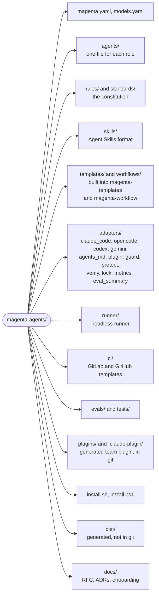

# Magenta Agents

A team of six role-based AI agents for software work: Product Manager, Software Architect, Senior Principal Engineer, QA Engineer, Software Engineer, and Front-End Engineer. The agents work alone or as a team. The success criteria and the rules of the agents become checks: commands that a machine runs. You approve the checks, and the work is done only when they pass.

- Design: [RFC-0001](docs/rfc/RFC-0001-magenta-agents.md)
- Decisions: [docs/adr/](docs/adr/)
- Team guide: [docs/onboarding.md](docs/onboarding.md)

## Status

All phases are implemented. They wait for the first real test.

| Phase | Content |
|---|---|
| 0. Foundations | Constitution, templates, workflows, `discover-project`, Claude Code adapter, guard hook |
| 1. Advisors | `magenta-principal`, `magenta-product-manager`, `magenta-architect`, `magenta-qa` |
| 2. Makers | `magenta-engineer`, `magenta-frontend`, maker skills, acceptance-test lock |
| 3. Other tools and vendors | OpenCode and AGENTS.md (Codex CLI) adapters, model profiles for other vendors |
| 4. Runner | Headless `prd-review` and `pr-review`, budgets, logs, GitLab and GitHub CI templates |
| 5. Team rollout | Plugin and marketplace, onboarding guide, organization standards, metrics |
| 6. Conductor | `/magenta` for all daily tasks: task types, playbooks, dynamic teams, constraint ledger; entry points for Claude Code, OpenCode, Codex CLI, and Gemini CLI |
| 7. Verify first | Checks as the definition of done, human approval of checks, the verify script, a Stop hook, one lead with review lenses as the default mode, three-mode evals ([ADR-0012](docs/adr/0012-verify-first.md)) |

## Install

Magenta installs from this GitHub repository on macOS, Linux, and Windows.

| | macOS | Linux | Windows |
|---|---|---|---|
| Claude Code plugin | Yes | Yes | Yes (Claude Code uses Git Bash) |
| Installer script | `install.sh` | `install.sh` | `install.ps1` |
| Necessary | Python 3.9+, git | Python 3.9+, git | Python 3.9+, Git for Windows |

### Option 1: Claude Code plugin (recommended for teams)

```bash
claude plugin marketplace add devlnull/magenta-agents
claude plugin install magenta@magenta-marketplace
```

The agents are `magenta:principal`, `magenta:product-manager`, `magenta:architect`, `magenta:qa`, `magenta:engineer`, and `magenta:frontend`. Update: `claude plugin marketplace update magenta-marketplace`.

### Option 2: installer script (Claude Code user level, OpenCode, Codex CLI, or Gemini CLI)

macOS and Linux:

```bash
curl -fsSL https://raw.githubusercontent.com/devlnull/magenta-agents/main/install.sh | sh
# other tool or version:
curl -fsSL https://raw.githubusercontent.com/devlnull/magenta-agents/main/install.sh | sh -s -- --target codex --ref v0.7.0
```

Windows (PowerShell):

```powershell
irm https://raw.githubusercontent.com/devlnull/magenta-agents/main/install.ps1 | iex
# other tool or version: set $env:MAGENTA_TARGET = "opencode" and $env:MAGENTA_REF = "v0.7.0" first
```

The script downloads the source to `~/.magenta-agents`, builds it, and installs it. The guard hook uses the Python that ran the install. Run the script again to update. Use the plugin or the script for Claude Code, not both.

### Option 3: from a clone

```bash
git clone https://github.com/devlnull/magenta-agents.git && cd magenta-agents
python3 magenta.py validate && python3 -m unittest discover -s tests
python3 magenta.py build
python3 magenta.py install                     # Claude Code, user level
python3 magenta.py install --target opencode   # optional
python3 magenta.py install --target codex      # optional: custom agents and $magenta
python3 magenta.py install --target gemini     # optional: subagents and /magenta
```

On Windows, use `py -3` or `python` in place of `python3`. The install does not replace a file that Magenta did not generate. To remove the installed files: `python3 magenta.py uninstall`.

## Prepare a product repository

```bash
python3 ~/.magenta-agents/magenta.py init /path/to/repository   # .magenta/ (kept out of git) and the Claude Code hooks
cd /path/to/repository
claude                                        # then: /magenta <your task>
```

`init` adds two hooks to `.claude/settings.local.json` of the repository (Claude Code, user-level install): the Stop hook that enforces the checks, and a hook that protects the verify state. The plugin has these hooks already: use `init --no-hook` with the plugin. Remove the hooks with `magenta.py unhook <repo>`.

The first `/magenta` task asks to run discover-project. Review `.magenta/project-context.md` and confirm it. Then approve the project checks (build, lint, unit tests) that it proposes.

## Use: `/magenta`

Give Magenta any daily task in your own words. The conductor selects the task type and the mode, writes the success criteria and the rules as checks, gives the work to the right agents, and does not finish until the checks pass.

| Tool | Command |
|---|---|
| Claude Code | `/magenta <task>` (plugin: `/magenta:magenta <task>` if another `/magenta` exists) |
| OpenCode | `/magenta <task>` |
| Gemini CLI | `/magenta <task>` |
| Codex CLI | `$magenta <task>` |

Example:

```text
/magenta find the performance issues of GET /v2/addresses/default. The average is 10 ms now.
I need p95 at or below 5 ms; p99 can be 10 ms.
```

For this request, the conductor selects the task type "performance" and the default mode:

| Step | Who | What happens |
|---|---|---|
| 1. Checks first | QA | Writes a load test with the thresholds (for example k6 with `p(95)<5` and `p(99)<10`) and a regression test, as checks linked to the task. They fail now. |
| | Architect | Writes the structural constraints as checks: for example "the cache stays inside the address module" or "no new dependency". |
| 2. Checks gate | You | Read the checks and approve them. Only you can approve a check. |
| 3. Work | Engineer (the lead) | Profiles the code path, changes one thing at a time, and runs verify until all checks pass. |
| 4. Lenses | QA, Architect, Principal | Review the diff, read-only. A serious finding becomes a new check. |
| 5. Done gate | You | Read the report with the verify table. You merge, ask for more work, or stop. |

The result must meet the target **and** keep the rules of all agents: the ADRs and boundaries of the Architect, the tests and thresholds of QA, the readiness rules of the Principal, the project conventions, and your constraints. A faster solution that breaks a check is rejected. In Claude Code, the Stop hook does not let the agent finish while an approved check fails.

### Modes

| Mode | When | Agents |
|---|---|---|
| Default: lead, checks, lenses | Most tasks | QA and the Architect write checks, one lead does the work, one to three lenses review |
| Team | A PRD, a one-way-door decision, a change of a contract or a schema, money or security, more than one bounded context, a lead that failed three rounds | The playbook of the task type with its core team |

Start the request with `--team` or `--lead` to select the mode yourself.

### Task types

| Task type | Example request | Default mode: checks first, then the lead | Team mode: core team |
|---|---|---|---|
| bug | "/magenta orders over 1M fail with a rounding error" | QA: a test that reproduces the bug. Lead: Engineer. | QA, Engineer, Principal |
| performance | "/magenta reduce the p99 of the search API to 50 ms" | QA: thresholds. Architect: constraints. Lead: Engineer. | QA, Engineer, Architect, Principal |
| improvement | "/magenta remove the duplicated price rules in checkout" | QA: characterization tests. Architect: target rules. Lead: Engineer. | Architect, QA, Engineer, Principal |
| investigation | "/magenta why does the stock sync job run twice?" | No checks. The experts answer, read-only. | Only the experts that the question needs |
| review | "/magenta review my branch against main" | No lead. The review panel. | QA, Architect, Principal |
| incident | "/magenta payments fail since the last deploy" | Lead: Engineer. A check for the failure mode, when there is time. | Principal, Engineer, QA |
| security | "/magenta fix CVE-2026-1234 in our JWT library use" | Always team mode. | Principal, Architect, Engineer, QA |
| upgrade | "/magenta upgrade Spring Boot from 3.3 to 3.5" | The project checks and smoke tests. Lead: Engineer. | Engineer, QA, Principal |
| tests | "/magenta fix the flaky OrderCancelTest" | The project checks. Lead: QA. | QA, Engineer |
| design | "/magenta design the retry strategy for the shipping events" | Lead: Architect. | Architect, Principal |
| feature | "/magenta implement this PRD: ..." | Small and clear: QA acceptance tests. Lead: Engineer or Front-End. | PM, Architect, QA, Engineer, Principal |

The routing table and the playbooks are in [`workflows/`](workflows/). The conductor uses the smallest team that covers the risks.

### Gates

You stay in control. In the default mode, you have two gates: the checks gate (you approve the checks, which are the definition of done, and a short plan) and the done gate. Team mode adds the plan gate, and features add the PRD gate. Magenta never pushes or merges.

### Checks

A check is a command that tests one rule. Exit code 0 means PASS. Each owner has one file in `.magenta/checks/`: `qa.yaml`, `architect.yaml`, `project.yaml` (Principal), and `human.yaml` (you). Example:

```yaml
checks:
  - id: qa.addresses-default-latency
    name: "GET /v2/addresses/default: p95 at or below 5 ms, p99 at or below 10 ms"
    command: k6 run --quiet perf/addresses-default.js
    set: full                      # quick: each run; full: --set full, or --set task for its work item; manual: --set all
    work_item: 20261030-addresses-latency
    why: "Success criteria of the task"
```

A check runs only after you approve its exact command, set, and work item. If an agent changes an approved check, the check fails until you approve the change. Your approval also seals the locked tests of the task. Approve the checks when the conductor asks:

```bash
python3 ~/.magenta-agents/magenta.py verify approve --repo .   # or, in Claude Code, type the command that Magenta shows after "!"
```

### More commands

| You want | Do this |
|---|---|
| One role only | `@magenta-architect`, `@magenta-qa`, and the other agents, in any session |
| The lead agent as the main session | `claude --agent magenta-principal` |
| Show the checks and their approval | `python3 magenta.py verify list --repo <repo>` |
| Approve new or changed checks (only you) | `python3 magenta.py verify approve --repo <repo>` |
| Run the checks | `python3 magenta.py verify run --repo <repo> [--set task\|full\|all]` |
| See the active task and the result for the current code | `python3 magenta.py verify status --repo <repo>` |
| Lock the tests of a work item | `python3 magenta.py lock <repo> <work-item> [--files <file> ...]` |
| Check the lock (QA, CI, pre-commit) | `python3 magenta.py check-lock <repo> <work-item>` |
| Compare plain, default, and team mode | `python3 magenta.py eval-summary` (see `evals/README.md`) |
| A headless PRD review | `python3 magenta.py run prd-review --repo <repo> --prd <file>` |
| A headless review panel (CI) | `python3 magenta.py run pr-review --repo <repo> --base origin/main` |
| Numbers for the retrospective | `python3 magenta.py metrics <repo> [<repo> ...]` |

Start each session in the root folder of the repository. The guard uses it as the project root.

## Enforcement

| Tool | How the rules are enforced | The checks |
|---|---|---|
| Claude Code (user level) | A `PreToolUse` guard hook in each agent (`~/.claude/magenta/guard.py`) | The verify script, and the Stop and protect hooks from `magenta.py init` |
| Claude Code (team plugin) | One plugin hook, `guard.py --auto`, that finds the agent by its name and protects the verify state for all sessions | The verify script, and the Stop hook of the plugin |
| OpenCode | Ordered permission rules in each agent | The verify script, run by the conductor (no Stop hook) |
| Codex CLI | Write and shell rules as instructions in each custom agent, plus the Codex sandbox and approvals | The verify script, run by the conductor (no Stop hook) |
| Gemini CLI | Write and shell rules as instructions in each subagent, plus the Gemini approvals | The verify script, run by the conductor (no Stop hook) |
| Other AGENTS.md tools | Instructions only. Use them for advisors. | Run verify yourself |

The guard blocks writes outside the files of the agent, access to secret paths, shell commands outside the allowlist, all shell operators (`;`, `|`, `>`, and more), the approve command, and writes to `.magenta/policy.json`, `.magenta/checks.lock`, `.magenta/verify-state.json`, `.magenta/active.json`, `acceptance.lock`, `.claude/`, and `.git/`.

The guard and the hooks are guardrails against mistakes, not a sandbox. The OpenCode, Codex CLI, and Gemini CLI adapters get bug fixes, but no new features (ADR-0012).

A repository can extend the rules in `.magenta/policy.json`. Only the human changes this file:

```json
{
  "qa":       { "writes": ["src/acceptanceTest/**"], "shell": ["./gradlew acceptanceTest*"] },
  "engineer": { "writes": ["!src/acceptanceTest/**"] }
}
```

## Models

Agents name a profile. `models.yaml` maps each profile to a model for each tool and to an engine for the runner. To use OpenAI, Gemini, Grok, or a self-hosted model, fill in the commented `opencode` and `runner` lines with model IDs that you have access to, then build again.

## Release a new version

1. Optional: copy `standards/organization.example.md` to `standards/organization.md` and write your organization standards.
2. Increase `release` in `magenta.yaml`.
3. Run `python3 magenta.py build`. It also updates the committed plugin (`plugins/magenta/`, `.claude-plugin/marketplace.json`).
4. Run `python3 magenta.py check` and the tests. Commit and push. CI tests macOS, Linux, and Windows.
5. Create a tag, for example `git tag v0.7.0 && git push origin v0.7.0`. Users can install that version with `--ref v0.7.0`.

## Repository layout



## Change the agents

1. Edit the source (never `dist/`).
2. Run `python3 magenta.py validate` and `python3 -m unittest discover -s tests`.
3. Run `python3 magenta.py build` and install again.
4. Run the evals (`evals/README.md`).
