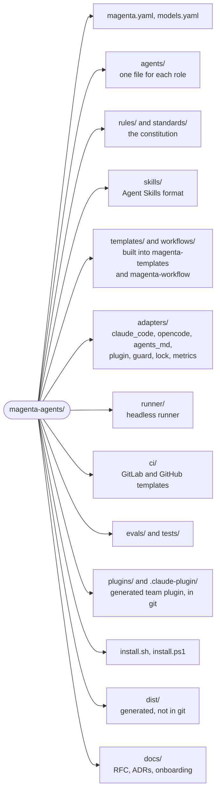

# Magenta Agents

A team of six role-based AI agents for software work: Product Manager, Software Architect, Senior Principal Engineer, QA Engineer, Software Engineer, and Front-End Engineer. The agents work alone or as a team. They hand off files with fixed templates, and a human approves each important decision.

- Design: [RFC-0001](docs/rfc/RFC-0001-magenta-agents.md)
- Decisions: [docs/adr/](docs/adr/)
- Team guide: [docs/onboarding.md](docs/onboarding.md)

## Status

All phases are implemented. They wait for the first real test.

| Phase | Content |
|---|---|
| 0. Foundations | Constitution, templates, workflows, `discover-project`, Claude Code adapter, guard hook |
| 1. Advisors | `magenta-principal`, `magenta-product-manager`, `magenta-architect`, `magenta-qa` |
| 2. Makers | `magenta-engineer`, `magenta-frontend`, maker skills, acceptance-test lock |
| 3. Other tools and vendors | OpenCode and AGENTS.md (Codex CLI) adapters, model profiles for other vendors |
| 4. Runner | Headless `prd-review` and `pr-review`, budgets, logs, GitLab and GitHub CI templates |
| 5. Team rollout | Plugin and marketplace, onboarding guide, organization standards, metrics |

## Install

Magenta installs from this GitHub repository on macOS, Linux, and Windows.

| | macOS | Linux | Windows |
|---|---|---|---|
| Claude Code plugin | Yes | Yes | Yes (Claude Code uses Git Bash) |
| Installer script | `install.sh` | `install.sh` | `install.ps1` |
| Necessary | Python 3.9+, git | Python 3.9+, git | Python 3.9+, Git for Windows |

### Option 1: Claude Code plugin (recommended for teams)

```bash
claude plugin marketplace add devlnull/magenta-agents
claude plugin install magenta@magenta-marketplace
```

The agents are `magenta:principal`, `magenta:product-manager`, `magenta:architect`, `magenta:qa`, `magenta:engineer`, and `magenta:frontend`. Update: `claude plugin marketplace update magenta-marketplace`.

### Option 2: installer script (user-level agents, OpenCode, or Codex CLI)

macOS and Linux:

```bash
curl -fsSL https://raw.githubusercontent.com/devlnull/magenta-agents/main/install.sh | sh
# other tool or version:
curl -fsSL https://raw.githubusercontent.com/devlnull/magenta-agents/main/install.sh | sh -s -- --target opencode --ref v0.5.0
```

Windows (PowerShell):

```powershell
irm https://raw.githubusercontent.com/devlnull/magenta-agents/main/install.ps1 | iex
# other tool or version: set $env:MAGENTA_TARGET = "opencode" and $env:MAGENTA_REF = "v0.5.0" first
```

The script downloads the source to `~/.magenta-agents`, builds it, and installs it. The guard hook uses the Python that ran the install. Run the script again to update. Use the plugin or the script for Claude Code, not both.

### Option 3: from a clone

```bash
git clone https://github.com/devlnull/magenta-agents.git && cd magenta-agents
python3 magenta.py validate && python3 -m unittest discover -s tests
python3 magenta.py build
python3 magenta.py install                     # Claude Code, user level
python3 magenta.py install --target opencode   # optional
python3 magenta.py install --target codex      # optional, advisors only
```

On Windows, use `py -3` or `python` in place of `python3`. The install does not replace a file that Magenta did not generate. To remove the installed files: `python3 magenta.py uninstall`.

## Prepare a product repository

```bash
python3 ~/.magenta-agents/magenta.py init /path/to/repository   # creates .magenta/ and keeps it out of git
cd /path/to/repository
claude --agent magenta-principal              # then ask: "Run discover-project."
```

Review `.magenta/project-context.md` and confirm it.

## Use

| You want | Do this |
|---|---|
| A complete work item with gates | `claude --agent magenta-principal`, then "New work item: <PRD link or text>" |
| One role only | `@magenta-product-manager`, `@magenta-architect`, `@magenta-qa`, `@magenta-engineer`, or `@magenta-frontend` in any session |
| A review of a branch | In a Principal session: "Run the PR review panel against main." |
| Lock the acceptance tests (you, after review) | `python3 magenta.py lock <repo> <work-item>` |
| Check the lock (QA, CI, pre-commit) | `python3 magenta.py check-lock <repo> <work-item>` |
| A headless PRD review | `python3 magenta.py run prd-review --repo <repo> --prd <file>` |
| A headless review panel (CI) | `python3 magenta.py run pr-review --repo <repo> --base origin/main` |
| Numbers for the retrospective | `python3 magenta.py metrics <repo> [<repo> ...]` |

Start each session in the root folder of the repository. The guard uses it as the project root.

## Enforcement

| Tool | How the rules are enforced |
|---|---|
| Claude Code (user level) | A `PreToolUse` guard hook in each agent (`~/.claude/magenta/guard.py`) |
| Claude Code (team plugin) | One plugin hook, `guard.py --auto`, that finds the agent by its name |
| OpenCode | Ordered permission rules in each agent |
| Codex CLI and other AGENTS.md tools | Instructions only. Use them for advisors. |

The guard blocks writes outside the files of the agent, access to secret paths, shell commands outside the allowlist, all shell operators (`;`, `|`, `>`, and more), and writes to `.magenta/policy.json`, `acceptance.lock`, `.claude/`, and `.git/`.

A repository can extend the rules in `.magenta/policy.json`. Only the human changes this file:

```json
{
  "qa":       { "writes": ["src/acceptanceTest/**"], "shell": ["./gradlew acceptanceTest*"] },
  "engineer": { "writes": ["!src/acceptanceTest/**"] }
}
```

## Models

Agents name a profile. `models.yaml` maps each profile to a model for each tool and to an engine for the runner. To use OpenAI, Gemini, Grok, or a self-hosted model, fill in the commented `opencode` and `runner` lines with model IDs that you have access to, then build again.

## Release a new version

1. Optional: copy `standards/organization.example.md` to `standards/organization.md` and write your organization standards.
2. Increase `release` in `magenta.yaml`.
3. Run `python3 magenta.py build`. It also updates the committed plugin (`plugins/magenta/`, `.claude-plugin/marketplace.json`).
4. Run `python3 magenta.py check` and the tests. Commit and push. CI tests macOS, Linux, and Windows.
5. Create a tag, for example `git tag v0.5.0 && git push origin v0.5.0`. Users can install that version with `--ref v0.5.0`.

## Repository layout



## Change the agents

1. Edit the source (never `dist/`).
2. Run `python3 magenta.py validate` and `python3 -m unittest discover -s tests`.
3. Run `python3 magenta.py build` and install again.
4. Run the evals (`evals/README.md`).
