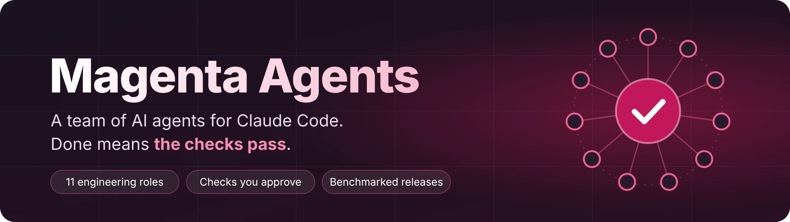
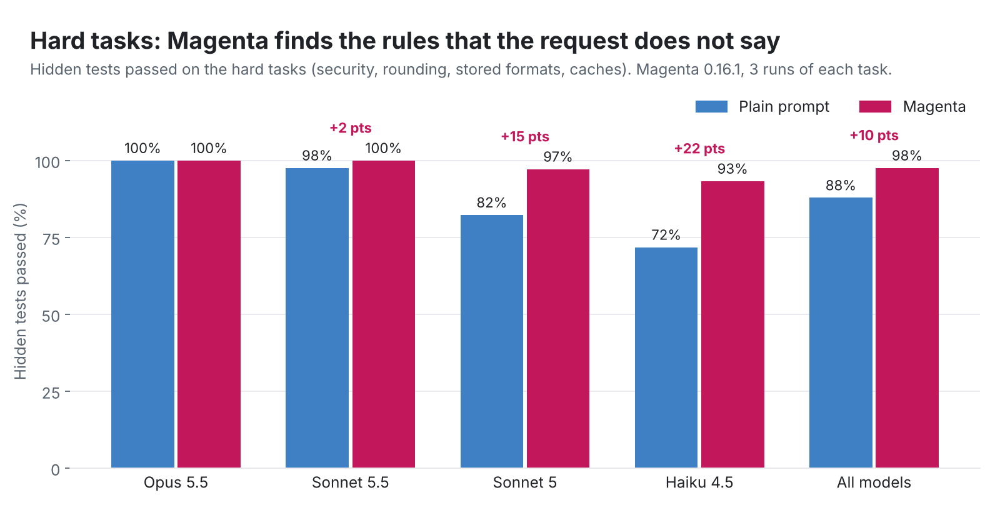
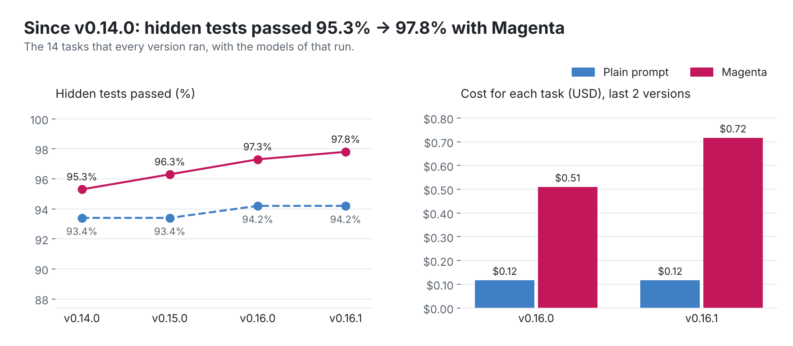
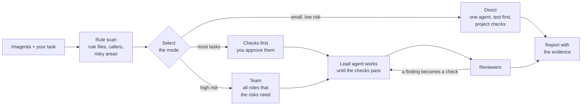

<p align="center">
  
</p>

<p align="center">
  <a href="https://github.com/devlnull/magenta-agents/actions/workflows/ci.yml"></a>
  <a href="https://github.com/devlnull/magenta-agents/releases"></a>
  <a href="evals/benchmark/README.md"></a>
  <a href="LICENSE"></a>
  
  <a href="https://github.com/devlnull/magenta-agents/stargazers"></a>
</p>

<p align="center">
  <a href="#quick-start">Quick start</a> ·
  <a href="#benchmark">Benchmark</a> ·
  <a href="#how-it-works">How it works</a> ·
  <a href="#the-agents">The agents</a> ·
  <a href="docs/guide.md">User guide</a>
</p>

**Magenta gives your coding agent an engineering team, and a definition of "done" that a machine checks.**

You type one command: `/magenta <task>`. Magenta reads the rules of your repository, turns your success criteria into **checks** (commands that a machine runs), and works until the checks pass. You approve the checks. Small tasks run fast in one agent. Risky tasks get the roles that they need: QA, Architect, Security, SRE, Database, and others.

It works best with [Claude Code](https://code.claude.com). OpenCode, Codex CLI, and Gemini CLI are also supported.

## Benchmark

<!-- benchmark:start -->
Measured on Magenta 0.16.0 (2026-11-03): 18 coding tasks with hidden tests, 4 Claude models, 3 runs of each task. The same model does the same task with a plain prompt and with `/magenta`.

<p align="center"></p>

| | Plain prompt | Magenta |
|---|---:|---:|
| Simple tasks | **99.0%** | 96.9% |
| Complex tasks (a spec) | **99.0%** | 98.7% |
| Hard tasks (hidden rules) | 87.9% | **96.6%** |
| Held-out tasks | **93.7%** | 90.6% |
| **All tasks** | 94.1% | **95.8%** |
| Old tests still pass | 210 of 216 | 214 of 216 |
| Cost for each task | $0.114 | $0.503 |

**Where Magenta helps:** tasks where the repository has rules that the request does not say (hard tasks: 88% → 97%), and smaller models. **Where it does not:** small, clear tasks with a strong model. There, a plain prompt is as good and cheaper.

**Best value:** Sonnet 5.5 with Magenta passed 100% of the hidden tests (54 of 54 runs with all hidden tests passed) at $0.14 for each task.

<p align="center"></p>

The tasks, the method, the limits, and the raw results: [evals/benchmark](evals/benchmark/README.md).
<!-- benchmark:end -->

## When to use Magenta

| Use Magenta when | A plain prompt is enough when |
|---|---|
| The repository has rules that the request does not say: security files, rounding rules, API conventions, stored formats | The change is small and clear, and you use a strong model |
| The change touches money, security, personal data, or a public API | You want the fastest and the cheapest answer |
| You want evidence: approved checks, tests that stay in the repository, and a record of each task | You will review each line yourself |
| You use a smaller model and want results near the results of a larger model | |

## Why Magenta

- **Evidence, not claims.** A task is done when the approved checks pass on the current code. In Claude Code, a hook does not let the agent stop before that.
- **You own the definition of done.** Only you approve a check. If an agent changes an approved check or a locked test, the check fails.
- **It reads your rules first.** A script finds the rule files of the repository and the other callers of the changed code before the work starts, with no model tokens.
- **The right team for the task.** Small, low-risk tasks run in one agent (direct mode). Other tasks get a lead and only the reviewers that the risks need. High-risk work gets the full team.
- **Guardrails.** The agents change the code freely, but not the checks, the approvals, the locked tests, or the secrets. Dangerous commands are blocked: no agent pushes, merges, or deploys.
- **Auto mode.** `/magenta --auto <task>` runs to the end. You see only the questions that only you can answer, and the final result.
- **Measured at each release.** Each version runs the [benchmark](evals/benchmark/README.md) before it is tagged.

## How it works



## Quick start

**Requirements:** Python 3.9 or later, git, and one of the supported tools. On Windows, Claude Code needs Git for Windows.

**1. Install.** For Claude Code, use the plugin:

```bash
claude plugin marketplace add devlnull/magenta-agents
claude plugin install magenta@magenta-marketplace
```

Or use the installer (Claude Code at user level, OpenCode, Codex CLI, or Gemini CLI):

```bash
curl -fsSL https://raw.githubusercontent.com/devlnull/magenta-agents/main/install.sh | sh
```

On Windows, use PowerShell: `irm https://raw.githubusercontent.com/devlnull/magenta-agents/main/install.ps1 | iex`. The [guide](docs/guide.md#install) shows the other options.

**2. Prepare your repository** (one time):

```bash
python3 ~/.magenta-agents/magenta.py init /path/to/your/repository
```

With the plugin, add `--no-hook`: the plugin has its own hooks.

**3. Run a task** in Claude Code, in the root folder of the repository:

```text
/magenta --auto add a status field (unpaid or paid) to the saved orders
```

```text
/magenta find the performance issues of GET /v2/addresses/default. The average is 10 ms now.
I need p95 at or below 5 ms; p99 can be 10 ms.
```

To see the task and the checks at any time, type `/magenta:task-status`. To run the checks now, type `/magenta:run-checks`.

## The agents

| Agent | Role |
|---|---|
| Product Manager | Reviews PRDs for value, evidence, and scope. Writes user stories. |
| Software Architect | Designs the structure, compares options, writes RFCs and ADRs, and writes the structural rules as checks. |
| Senior Principal Engineer | Plans, settles disagreements, checks production readiness, and does the final review. |
| QA Engineer | Writes the checks and the tests that define "done", finds edge cases, and gives the quality verdict. |
| Software Engineer | Implements server-side changes with TDD, in the patterns of your project. |
| Front-End Engineer | Implements client-side changes with performance, accessibility, and locale support. |
| Site Reliability Engineer | Defines SLOs and alerts, reviews resilience and rollout, leads incidents, and writes runbooks and postmortems. |
| Platform Engineer (DevOps) | Changes CI/CD pipelines, containers, Kubernetes and Helm, and Terraform. Never applies or deploys. |
| Security Engineer | Makes threat models, reviews code for security, triages CVEs, and keeps the scanners as checks. |
| Database Engineer | Plans zero-downtime migrations, tunes queries with evidence, and writes migration and query checks. |
| Technical Writer | Keeps the documentation, the changelog, and the release notes in agreement with the code. |

Most tasks use only a few of them. The [team page](docs/team.md) shows when each role joins and which files it owns.

## Documentation

| Document | Content |
|---|---|
| [User guide](docs/guide.md) | Install options, modes, task types, gates, checks, and daily use |
| [Reference](docs/reference.md) | Commands, configuration files, enforcement, and model profiles |
| [The team](docs/team.md) | The roles, when each one joins a task, and the files that each one owns |
| [Team guide](docs/onboarding.md) | A 15-minute introduction for an engineer in a team |
| [Benchmark](evals/benchmark/README.md) | The tasks, the method, the results of each version, and how to run it |
| [Architecture](docs/architecture.md) | How the source becomes the files of each tool |
| [Design (RFC-0001)](docs/rfc/RFC-0001-magenta-agents.md) and [decisions (ADRs)](docs/adr/) | The full design and the decision records |
| [Changelog](CHANGELOG.md) | The changes in each version |

## Status

Magenta is new (version 0.x). All features are implemented and tested by CI on macOS, Linux, and Windows. The commands and the file formats can change before 1.0. The [changelog](CHANGELOG.md) records each change, and the [benchmark](evals/benchmark/README.md) records the results of each version.

## Contributing

Contributions are welcome: new benchmark tasks, new roles, support for more tools, and bug reports. Read [CONTRIBUTING.md](CONTRIBUTING.md) first. To report a security problem, follow [SECURITY.md](SECURITY.md).

If Magenta helps you, give the repository a star. It helps other engineers find it.

## License

[MIT](LICENSE)
