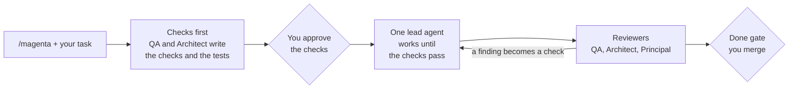

# Magenta Agents

[](https://github.com/devlnull/magenta-agents/actions/workflows/ci.yml)
[](https://github.com/devlnull/magenta-agents/releases)
[](LICENSE)


**A team of role-based AI agents for software engineering, where "done" means "the checks pass".**

Magenta gives your coding agent a team of eleven roles: product, architecture, engineering, QA, reliability (SRE), platform (DevOps), security, database, and documentation. You type one command, `/magenta <task>`. Magenta turns your success criteria and the rules of the roles into **checks**: commands that a machine runs. You approve the checks. One agent does the work until the checks pass, and the other roles review the result.

It works best with [Claude Code](https://code.claude.com). OpenCode, Codex CLI, and Gemini CLI are also supported.

## Why Magenta

- **Evidence, not claims.** A task is done when the approved checks pass on the current code. In Claude Code, a hook does not let the agent stop before that.
- **You own the definition of done.** Only you approve a check. If an agent changes an approved check or a locked test, the check fails.
- **The right team for the task.** Most tasks use one lead agent and one to three reviewers. High-risk work (a PRD, a contract change, security) uses the full team.
- **Your project, your conventions.** The agents learn the conventions of your repository first, and keep them.
- **Guardrails.** Each agent writes only its own files and runs only its allowed commands. No agent pushes, merges, or deploys.

## How it works



## Quick start

**Requirements:** Python 3.9 or later, git, and one of the supported tools. On Windows, Claude Code needs Git for Windows.

**1. Install.** For Claude Code, use the plugin:

```bash
claude plugin marketplace add devlnull/magenta-agents
claude plugin install magenta@magenta-marketplace
```

Or use the installer (Claude Code at user level, OpenCode, Codex CLI, or Gemini CLI):

```bash
curl -fsSL https://raw.githubusercontent.com/devlnull/magenta-agents/main/install.sh | sh
```

On Windows, use PowerShell: `irm https://raw.githubusercontent.com/devlnull/magenta-agents/main/install.ps1 | iex`. The [guide](docs/guide.md#install) shows the other options.

**2. Prepare your repository** (one time):

```bash
python3 ~/.magenta-agents/magenta.py init /path/to/your/repository
```

With the plugin, add `--no-hook`: the plugin has its own hooks.

**3. Run a task** in Claude Code, in the root folder of the repository:

```text
/magenta find the performance issues of GET /v2/addresses/default. The average is 10 ms now.
I need p95 at or below 5 ms; p99 can be 10 ms.
```

To see the task and the checks at any time, type `/magenta:task-status`. To run the checks now, type `/magenta:run-checks`.

The first task asks to learn your repository (discover-project). Then QA writes a load test with the thresholds, and the Architect writes the structural rules. You approve them. The Engineer profiles and changes the code until all checks pass. The reviewers check the result, and you get a report with the evidence.

## The agents

| Agent | Role |
|---|---|
| Product Manager | Reviews PRDs for value, evidence, and scope. Writes user stories. |
| Software Architect | Designs the structure, compares options, writes RFCs and ADRs, and writes the structural rules as checks. |
| Senior Principal Engineer | Plans, settles disagreements, checks production readiness, and does the final review. |
| QA Engineer | Writes the checks and the tests that define "done", finds edge cases, and gives the quality verdict. |
| Software Engineer | Implements server-side changes with TDD, in the patterns of your project. |
| Front-End Engineer | Implements client-side changes with performance, accessibility, and locale support. |
| Site Reliability Engineer | Defines SLOs and alerts, reviews resilience and rollout, leads incidents, and writes runbooks and postmortems. |
| Platform Engineer (DevOps) | Changes CI/CD pipelines, containers, Kubernetes and Helm, and Terraform. Never applies or deploys. |
| Security Engineer | Makes threat models, reviews code for security, triages CVEs, and keeps the scanners as checks. |
| Database Engineer | Plans zero-downtime migrations, tunes queries with evidence, and writes migration and query checks. |
| Technical Writer | Keeps the documentation, the changelog, and the release notes in agreement with the code. |

Most tasks use only a few of them. The [team page](docs/team.md) shows when each role joins and which files it owns.

## Documentation

| Document | Content |
|---|---|
| [User guide](docs/guide.md) | Install options, modes, task types, gates, checks, and daily use |
| [Reference](docs/reference.md) | Commands, configuration files, enforcement, and model profiles |
| [The team](docs/team.md) | The roles, when each one joins a task, and the files that each one owns |
| [Team guide](docs/onboarding.md) | A 15-minute introduction for an engineer in a team |
| [Architecture](docs/architecture.md) | How the source becomes the files of each tool |
| [Design (RFC-0001)](docs/rfc/RFC-0001-magenta-agents.md) and [decisions (ADRs)](docs/adr/) | The full design and the decision records |
| [Changelog](CHANGELOG.md) | The changes in each version |

## Status

Magenta is new (version 0.x). All features are implemented and tested by CI on macOS, Linux, and Windows. Real-world use has just started, so the commands and the file formats can change before 1.0. The [changelog](CHANGELOG.md) records each change.

## Contributing

Contributions are welcome. Read [CONTRIBUTING.md](CONTRIBUTING.md) first. To report a security problem, follow [SECURITY.md](SECURITY.md).

## License

[MIT](LICENSE)
