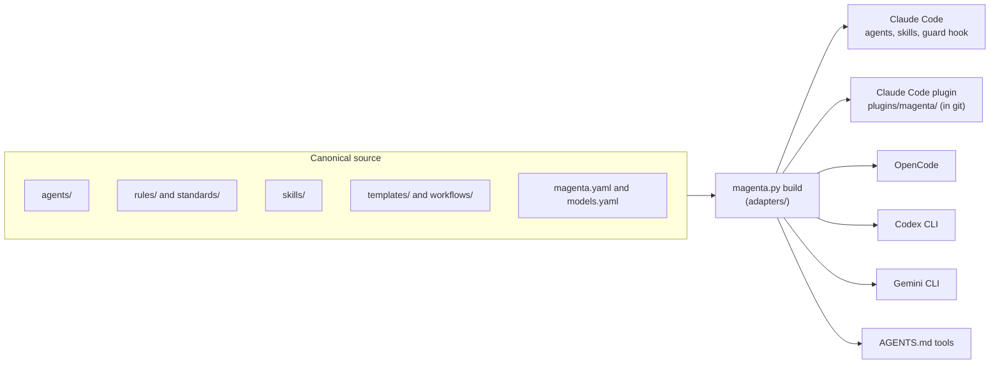

# Architecture

Magenta is "agents as code". One canonical, tool-neutral source builds the native files of each tool. The full design is in [RFC-0001](rfc/RFC-0001-magenta-agents.md). The decisions are in [`adr/`](adr/).

## From source to tools

## Repository layout

| Folder | Content |
|---|---|
| `agents/` | One file for each role: instructions, tools, write rules, shell allowlist |
| `rules/` | The constitution that all agents follow |
| `skills/` | Skills in the Agent Skills format, including the `/magenta` conductor |
| `templates/`, `workflows/` | Artifact templates and playbooks, built into the skills `magenta-templates` and `magenta-workflow` |
| `adapters/` | The build for each tool, the guard, the verify script, and the test lock |
| `runner/` | The headless runner for CI |
| `ci/` | CI templates for product repositories (GitHub Actions, GitLab CI) |
| `evals/` | Golden tasks, rubrics, and the mode comparison |
| `tests/` | Unit tests |
| `plugins/`, `.claude-plugin/` | The generated Claude Code plugin and marketplace (committed, so that GitHub can serve it) |
| `docs/` | Guides, the RFC, the ADRs, and the release notes |

## Runtime parts

| Part | File | Job |
|---|---|---|
| Conductor | `skills/magenta/SKILL.md` | Runs `/magenta`: routes the task, gets the checks, starts the agents, reports |
| Guard | `adapters/guard.py` | A PreToolUse hook: file ownership, secret paths, shell allowlist |
| Verify | `adapters/verify.py` | The checks registry, approvals, runs, the Stop hook, and the protect hook |
| Test lock | `adapters/lock.py` | Hashes of the locked test files of a work item |
