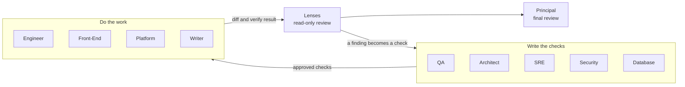

# The team

Magenta has eleven roles. A task uses only the roles that its risks need. The conductor (`/magenta`) selects them with the routing table in [`workflows/routing.md`](../workflows/routing.md).

## Roles

| Agent | Type | Joins a task when | Owns | Checks file | Lens |
|---|---|---|---|---|---|
| `principal` | lead | standard and full lanes, conflicts, final review | plan, project context, final review | `project.yaml` | Principal |
| `product-manager` | advisor | a PRD, or a change of user-facing scope | PRD review, stories | - | - |
| `architect` | advisor | the change touches structure | design, ADRs, RFCs, architecture tests | `architect.yaml` | Architect |
| `qa` | reviewer | each change of behavior | test plan, tests, quality verdict | `qa.yaml` | QA |
| `engineer` | maker | server code | server code, migration code | - | - |
| `frontend` | maker | client code | client code | - | - |
| `sre` | reviewer | production behavior changes, incidents, SLOs | reliability design, runbooks, postmortems | `sre.yaml` | SRE |
| `platform` | maker | pipelines, containers, deployment, infrastructure | CI/CD, Docker, Kubernetes, Helm, Terraform, alert rules | - | - |
| `security` | reviewer | authentication, input from outside, secrets, money, personal data, dependencies | threat model, scanner rules, security verdict | `security.yaml` | Security |
| `database` | advisor | schema, migration, backfill, index, slow query | migration plan, query plans | `database.yaml` | Database |
| `writer` | maker | user documentation or release notes are part of "done" | docs, READMEs, changelog | - | - |

**Types.** A *maker* changes production files. A *reviewer* or an *advisor* writes designs, checks, and findings, but no production code. A *lead* plans and does the final review.

## How the roles work together

Two rules keep the result honest:

1. **Maker and checker are different agents.** A maker never writes the checks that judge its work. Only the human approves a check.
2. **One owner for each file.** The guard blocks a write to a file of another role. For example, only the Platform Engineer changes CI pipelines, and only the Security Engineer changes scanner rules and ignore files. A maker reports a needed change to the owner.

## File ownership in a product repository

| Files | Owner |
|---|---|
| Application code and tests that the plan gives to the maker | `engineer`, `frontend` |
| Migration code (from the plan in `03-data.md`) | `engineer` |
| `.github/workflows/`, `.gitlab-ci.yml`, `Jenkinsfile`, Dockerfiles, Compose files, `*.tf`, Helm charts, `k8s/`, `deploy/`, `infra/`, `monitoring/`, alert rules | `platform` |
| Tests in the test folders | `qa` (the makers add their own unit tests; locked tests stay as QA wrote them) |
| `*ArchTest*`, dependency-cruiser and import-linter configuration, `docs/adr/`, `docs/rfc/`, `docs/architecture/` | `architect` |
| `.semgrep.yml`, `.semgrep/`, `.gitleaks.toml`, `.trivyignore`, `.snyk`, `osv-scanner.toml` | `security` |
| `docs/runbooks/`, `docs/postmortems/` | `sre` |
| Other docs, READMEs, `CHANGELOG.md` | `writer` (the makers can update docs in their scope) |
| `.magenta/checks/<role>.yaml` | the role in the file name; `human.yaml`: you |
| `.magenta/policy.json`, `.magenta/checks.lock` | you (the human) |

A repository can change these rules in `.magenta/policy.json`. See the [reference](reference.md#magentapolicyjson).

## Roles that we did not add

| Role | Why not now |
|---|---|
| Performance Engineer | QA (measurement), SRE (capacity), and Database (queries) cover it, with the skill `performance-investigation`. |
| Release Manager | The release workflow, the Platform Engineer, and the done gate cover it. |
| UX Designer | Agents cannot judge visual design well yet. The Front-End Engineer covers accessibility and states. |
| Mobile Engineer | The Front-End Engineer covers web and mobile clients. Add a role if native mobile work grows. |
| Data or Product Analyst | A good candidate for the next step: experiment design, metrics, and the analysis of A/B tests for the Product Manager. |
| FinOps | The SRE covers capacity and cost estimates. |
