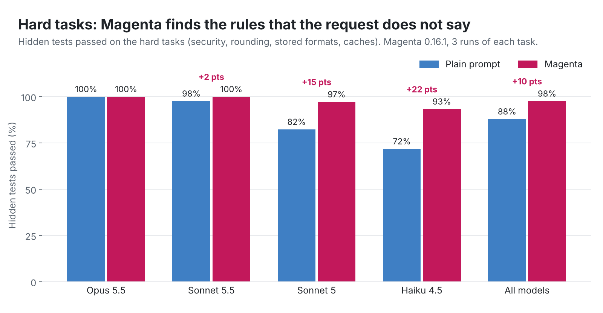
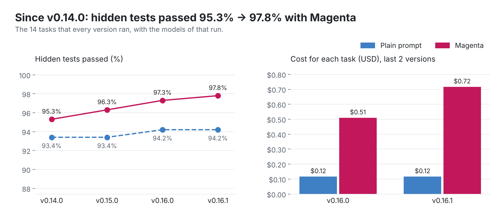

# Benchmark

Each release of Magenta runs the same benchmark before it is tagged. The release workflow stops when the results of the new version are missing. Thus you can compare the versions, and see what each version improves.



## Method

- **Tasks:** 18 coding tasks in small Python repositories (the table below). Each task has a set of **hidden tests** that the agent never sees. The score is the part of these tests that pass after the task. We also check that the tests that were in the repository before the task still pass.
- **Two modes, same model, same task:**
  - **plain:** `claude -p "<task>"`.
  - **magenta:** `claude -p "/magenta:magenta --auto <task>"` with the plugin of that version. All agents use the same model. The repository is prepared (a confirmed project profile and an approved project check). A simulated human approves the checks that the agents propose.
- **Models:** Opus 5.5, Sonnet 5.5, Sonnet 5, and Haiku 4.5.
- **Runs:** 3 runs of each task, mode, and model. The ± value is the standard deviation of the 3 runs.
- **Held-out tasks:** h7 to h10 were written after Magenta 0.15 and were not used to tune Magenta. They show if a gain is general or only on the tasks that we know.
- **Cost:** the `total_cost_usd` that Claude Code reports, with prompt caching.

## Kinds of tasks

| Kind | What it tests |
|---|---|
| **Simple** | A small, clear change. A strong model does it well without help. |
| **Complex** | A feature from a spec file (`SPEC.md` or `RULES.md`). |
| **Hard** | A rule that is not in the request but in the repository: a comment, a docstring, `SECURITY.md`, `ARCHITECTURE.md`, a stored format, or other callers. |
| **Held-out** | Hard tasks of the same type that Magenta was not tuned on. |

## Tasks and results of the newest version

<!-- scenarios:start -->
| Task | Kind | What the hidden tests check | Plain | Magenta |
|---|---|---|---:|---:|
| `s1-pagination` | simple | Fix an off-by-one in paginate; bad page and size raise the error that the docstring gives | 100% | 98% |
| `s2-discount` | simple | Round a discount half up; reject a percent outside 0 to 100 as the docstring says | 96% | 97% |
| `s3-slugify` | simple | Add max_length to slugify: cut at a word, no last dash, old behavior kept | 100% | 100% |
| `s4-email-refactor` | simple | Merge two email checks into one function; each caller keeps its own behavior | 100% | 100% |
| `c1-order-totals` | complex | Order totals follow RULES.md: discount order, VAT after discount, free shipping, half-up rounding | 99% | 99% |
| `c2-rate-limit` | complex | A token-bucket login limit for each IP and each user, with retry-after (SPEC.md) | 98% | 94% |
| `c3-csv-import` | complex | A CSV product import with validation, line numbers, and duplicate SKUs (SPEC.md) | 100% | 98% |
| `c4-idempotent-save` | complex | Idempotent order save: the same request gives the same order, a paid order is not reused (SPEC.md) | 99% | 98% |
| `h1-rounding-trap` | hard | VAT rounds half up, but refunds must still round down (a rule in a comment) | 92% | 100% |
| `h2-duplicates-speed` | hard | Make find_duplicates fast, and keep the form and the order of the result | 100% | 98% |
| `h3-invoice-download` | hard | Download an invoice: owner or admin only, no path traversal, only PDF (SECURITY.md) | 84% | 100% |
| `h4-price-cache` | hard | Cache prices, but never return an old price after set_price | 100% | 100% |
| `h5-orders-format` | hard | Add a field to a stored file format: old files still load, bad values are rejected | 79% | 88% |
| `h6-split-utils` | hard | Split a module: the old imports still work, no copied code | 72% | 100% |
| `h7-user-export` | held-out | Export users as CSV: support staff see masked email and phone, deleted users are hidden | 85% | 83% |
| `h8-api-field` | held-out | Add a field to an API response with the naming rules of the API (snake_case, _rials, int) | 98% | 85% |
| `h9-catalog-cache` | held-out | Cache a parsed file, but see a change to the file, and keep two files separate | 100% | 97% |
| `h10-retry-client` | held-out | Retry GET on a timeout or 503, at most 3 tries; never retry POST or a 4xx | 92% | 100% |
<!-- scenarios:end -->

## Results of each version

| Version | Results | Notes |
|---|---|---|
| 0.16.1 | [results/v0.16.1.json](results/v0.16.1.json) | New Magenta runs for Sonnet 5.5 and Haiku 4.5 (the mode fix). The other runs are the runs of 0.16.0. |
| 0.16.0 | [results/v0.16.0.json](results/v0.16.0.json) | 18 tasks, 4 models, 3 runs. |
| 0.15.0 | [results/v0.15.0.json](results/v0.15.0.json) | 14 tasks, 4 models, 1 run. The plain runs are the runs of 0.14.0. |
| 0.14.0 | [results/v0.14.0.json](results/v0.14.0.json) | The first benchmark: 14 tasks, 4 models, 1 run. |



The version chart uses only the 14 tasks that all versions ran. The analysis of the older runs is in [archive/](archive/README.md).

More images: [by kind of task](../../docs/assets/benchmark/by-kind.png), [by model](../../docs/assets/benchmark/by-model.png), [cost](../../docs/assets/benchmark/cost.png), and a [card to share](../../docs/assets/benchmark/card.png).

## Limits

- Small repositories, and tasks that one person wrote. Real repositories have more rules and more code.
- Headless runs with `bypassPermissions` and a simulated approval. In real use, you approve the checks.
- 3 runs: a difference of 1 or 2 points can be noise.
- The hidden tests do not measure all the value of Magenta, for example the tests that it leaves in the repository and the record of each task.

## Run the benchmark for a release

You need the Claude Code CLI with a login, Python 3, and matplotlib. A full run takes about 1 to 2 hours and uses API credit: about 130 USD with the 4 models (most of it Opus 5.5 and Sonnet 5), about 25 USD with Sonnet 5.5 and Haiku 4.5 only.

```bash
cd evals/benchmark
python3 release.py run 0.17.0          # the committed plugin of the working tree; or --ref v0.17.0
python3 release.py collect 0.17.0      # writes results/v0.17.0.json
python3 release.py publish             # the images in docs/assets/benchmark/ and the README blocks
python3 release.py check 0.17.0        # the release workflow runs this
```

To run fewer models: `--models claude-sonnet-5-5,claude-haiku-4-5`. To run one task: `python3 bench.py <model> plain,magenta <task> 1 1` with `BENCH_TAG` set.
