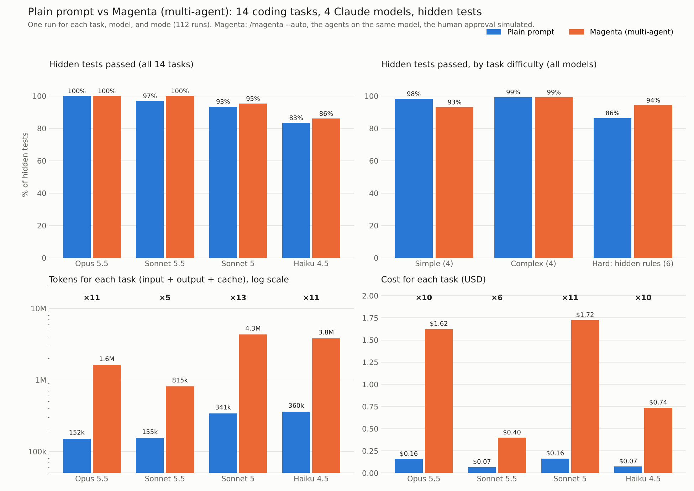
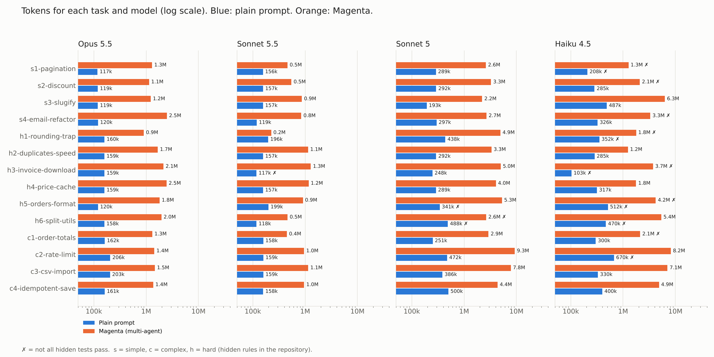
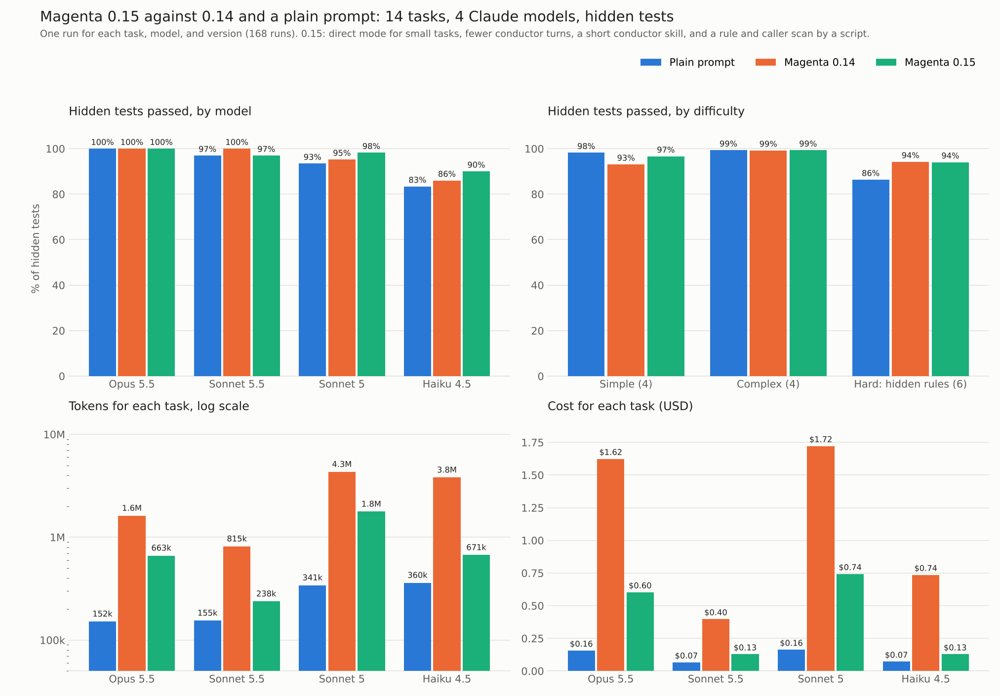
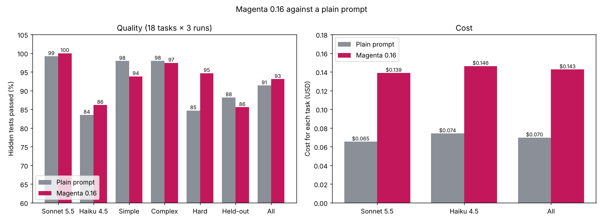

# Archive: the analysis of the first benchmarks

These are the notes and scripts of the benchmarks of 0.14, 0.15, and 0.16 as they were written at that time. The scripts expect `bench.py`, `fixtures/`, and the run folders in the folder above. The current method and results are in [../README.md](../README.md), and the data of each version is in [../results/](../results/).

## Magenta 0.14 (2026-11-03)

14 coding tasks in small Python repositories, 4 Claude models, 2 modes, one run each (112 runs). The score is a set of hidden tests that the agent never sees.

- **Simple (4):** a pagination bug, discount rounding, a slugify option, an email validation refactor.
- **Complex (4):** order totals by a rules file, a login rate limit, a CSV import, an idempotent order save.
- **Hard (6):** each one has a rule that is not in the prompt but in the repository: a refund that must round down, a docstring contract under a speed target, a security file for a download, an architecture rule against stale cache reads, old file formats that must stay readable, and a public API that must not break.

Modes: **plain** is `claude -p "<task>"`. **magenta** is `claude -p "/magenta:magenta --auto <task>"` with the plugin 0.14.0, all agents on the same model, a prepared repository (confirmed profile, approved project check), and a simulated human who approves the checks that the agents propose.




| Model | Hidden tests, plain | Hidden tests, Magenta | All passed, plain / Magenta | Tokens for each task, plain / Magenta | Cost for each task, plain / Magenta |
|---|---|---|---|---|---|
| Opus 5.5 | 100% | 100% | 14 / 14 | 152k / 1.6M (×11) | $0.16 / $1.62 (×10) |
| Sonnet 5.5 | 97% | 100% | 13 / 14 | 155k / 815k (×5) | $0.07 / $0.40 (×6) |
| Sonnet 5 | 93% | 95% | 12 / 13 | 341k / 4.3M (×13) | $0.16 / $1.72 (×11) |
| Haiku 4.5 | 83% | 86% | 8 / 7 | 360k / 3.8M (×11) | $0.07 / $0.74 (×10) |
| **All** | **93.5%** | **95.3%** | **47 / 48 of 56** | 252k / 2.6M (×10) | $0.11 / $1.12 (×10) |

By difficulty (all models): simple 98% → 93%, complex 99% → 99%, hard 86% → 94%.

Other measures: tests left in the repository for each task: 1.0 (plain) against 11.5 (Magenta). Old tests broken: 2 runs (plain) against 1 (Magenta). Time for each task: 24 s against 321 s. Output tokens for each task: 2.1k against 30k. Total cost of the benchmark: about 70 USD.

### Findings

1. On clear, small tasks, Magenta gives no gain and costs about 10 times more. Opus 5.5 passed all tasks in both modes.
2. On hard tasks with hidden rules, Magenta gives +8 points: Haiku 4.5 68% → 88%, Sonnet 5 85% → 89%, Sonnet 5.5 93% → 100% (it found the security rules of the download). Opus 5.5: 100% in both modes.
3. On simple tasks, Magenta with Haiku 4.5 was worse (93% → 72%): the long process is too much for the small model.
4. Magenta leaves about 11 new tests for each task, and a work item with the checks. The hidden tests do not measure this value.

### Limits

- One run for each cell: one task can change a result by several points.
- Small repositories and tasks that one person wrote. Real repositories have more hidden rules.
- Headless runs, `bypassPermissions`, and a simulated approval.
- Tokens include the cached system prompt and the cached context, so the counts are high also for the plain runs.

### Run it again

```bash
tar -xf fixtures.tar                  # the tasks and the hidden tests
mkdir src && git -C <magenta-agents> archive v0.14.0 | tar -x -C src
python3 bench.py claude-opus-5-5,claude-sonnet-5-5 plain,magenta all 1 6
python3 analyze.py && python3 charts.py
```

## Magenta 0.15 (2026-11-03)



0.15 changes: direct mode for small tasks (the conductor does the work itself, with the project checks), `verify begin`, `gate`, and `close` (fewer conductor turns), a conductor skill of 15 KB in place of 34 KB, a one-line result when all checks pass, and `verify context` (a script that finds the rule files and the callers of the changed functions, with no model tokens). Same tasks, same models, one run each.

| | Plain prompt | Magenta 0.14 | Magenta 0.15 |
|---|---|---|---|
| Hidden tests passed | 93.4% | 95.3% | **96.3%** |
| Tasks with all hidden tests passed | 47 of 56 | 48 of 56 | **50 of 56** |
| Old tests still pass | 54 of 56 | 55 of 56 | **56 of 56** |
| Tokens for each task | 252k | 2.64M | **836k** (−68%) |
| Cost for each task | $0.11 | $1.12 | **$0.40** (−64%) |
| Time for each task | 24 s | 321 s | **106 s** |

By model (hidden tests, 0.14 → 0.15; tokens saved): Opus 5.5 100% → 100% (−59%), Sonnet 5.5 100% → 97% (−71%; one security task raised `PermissionError` where the rule says `ValueError`), Sonnet 5 95% → 98% (−59%), Haiku 4.5 86% → 90% (−82%). By difficulty: simple 93% → 97%, complex 99% → 99%, hard 94% → 94%. The conductor selected direct mode in 34 of 56 runs.

## Magenta 0.16 (2026-11-03)



0.16 changes: the direct-mode verdict of `verify context`, the rule "follow the rules of the repository exactly", Sonnet as the default strong model, and a fix that keeps all lines of a rule in the `context` output.

This run is larger: 18 tasks (14 old tasks and 4 held-out tasks, h7 to h10, that were not used to tune Magenta), 2 models, and 3 runs for each cell (108 runs for each mode). The ± value is the standard deviation of the 3 runs.

| | Plain prompt | Magenta 0.16 |
|---|---|---|
| Hidden tests passed | 91.4% ±2.3 | **93.1% ±0.9** |
| Tasks with all hidden tests passed | 85 of 108 | **86 of 108** |
| Old tests still pass | 106 of 108 | **108 of 108** |
| Tokens for each task | **261k** | 509k |
| Cost for each task | **$0.070** | $0.143 |
| Time for each task | **26 s** | 51 s |

| Scope | Plain prompt | Magenta 0.16 |
|---|---|---|
| Sonnet 5.5 | 99.2% | **100%** (54 of 54) |
| Haiku 4.5 | 83.5% | **86.1%** |
| Simple tasks | **97.9%** | 93.8% |
| Complex tasks | **98.0%** | 97.4% |
| Hard tasks (hidden rules) | 84.7% | **94.7%** |
| Held-out tasks | **88.2%** | 85.6% |

### Findings

1. Magenta gives the most on hard tasks with hidden rules (+10 points). Haiku 4.5: 71.8% → 89.4%.
2. With Sonnet 5.5, Magenta passed all hidden tests in all runs. The plain prompt failed one task once.
3. Magenta never broke an old test. The plain prompt broke old tests in 2 runs.
4. With Haiku 4.5, Magenta was worse on simple tasks (95.8% → 87.6%) and on held-out tasks (76.4% → 71.1%). The small model fails the same way in each run (for example s1: 5 of 7, h7: 3 of 6, h8: 2 of 5).
5. The cost is about two times the cost of a plain prompt. Compare: 0.14 was about ten times.
6. The conductor did most tasks in direct mode. It started other agents rarely.

### Run it again

```bash
tar -xf fixtures.tar
mkdir src-016 && git -C <magenta-agents> archive v0.16.0 | tar -x -C src-016
BENCH_TAG=016 python3 bench.py claude-sonnet-5-5,claude-haiku-4-5 plain,magenta all 3 6
python3 final016.py && python3 charts016.py
```
