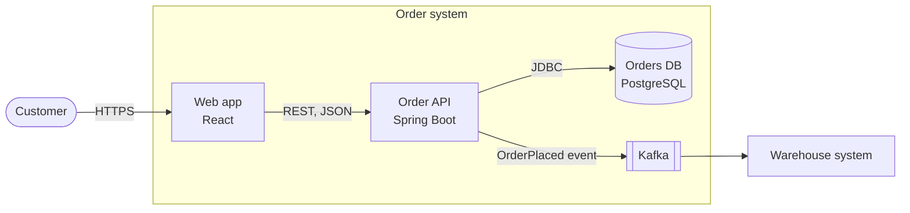

<!-- Generated by magenta build. Do not edit this file. -->

# Diagrams in Mermaid

## Rules

- Use Mermaid code blocks only. Do not use images or ASCII art.
- One diagram shows one idea. Keep it under about 20 nodes.
- Use flowcharts with subgraphs for the C4 levels. Some viewers do not show the Mermaid C4 syntax.
- Give each element a name and a short responsibility. Label each arrow with the interaction (for example "HTTPS, JSON" or "Kafka event").
- Keep the diagram and the text in agreement.

## C4 container example

## Other diagram types

- Interactions in time: `sequenceDiagram`.
- Life cycles (for example an order): `stateDiagram-v2`.
- Data models: `erDiagram`.
- Bounded contexts: a flowchart with one subgraph for each context. Label each relation with the DDD pattern (for example ACL, OHS, conformist).
