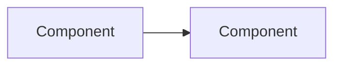
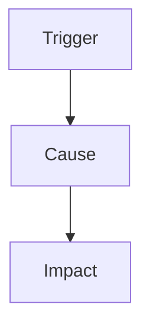
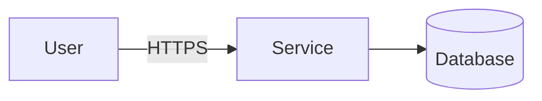

<!-- Generated by magenta build. Do not edit this file. -->

# Magenta artifact templates

Copy the template. Replace each `<...>` placeholder. Delete the sections that do not apply, and write the reason in the handoff note.

## Template: adr

````markdown
# ADR-NNNN: <decision title>

| Field | Value |
|---|---|
| Status | Proposed |
| Date | <date> |
| Decider | <human> |
| Source | <work item, RFC, or design note> |

## Context
## Decision
## Options considered
## Consequences
- Good:
- Bad:
- Follow-up:
## Reversibility
One-way door / two-way door. Reason:
````

## Template: brief

````markdown
# Brief: <title>

| Work item | Step | Owner | Status | Inputs (commit SHA) |
|---|---|---|---|---|
| <ID>-<slug> | <step> | <agent> | DRAFT / DONE / BLOCKED / NEEDS-HUMAN | <files> @ <sha> |

## Task
- Task type: <bug | performance | improvement | feature | investigation | review | incident | security | upgrade | infrastructure | reliability | data | docs | tests | design>
- Mode: <default | team>. Reason (the team trigger, or `--lead`):
- Playbook (team mode): <name>
- Lane: <lite | standard | full>. Reason:
- Goal (one sentence):

## Success criteria
| Metric or check | Current value (source) | Target | How we measure |
|---|---|---|---|

## Scope
- In:
- Out:

## Checks
| Check | Owner | What it tests | Set | Red before the change? |
|---|---|---|---|---|

## Agents
| Agent | Part (lead, checks, lens) | Reason |
|---|---|---|

## Constraints known now
- 

## Assumptions and questions
- ASSUMPTION:
- QUESTION:

## Plan and constraint ledger (default mode)

## Handoff

- Done:
- Open:
- Next owner:
- What to check:
````

## Template: cdr

````markdown
# CDR: <short title>

| Work item | Step | Owner | Status | Inputs (commit SHA) |
|---|---|---|---|---|
| <ID>-<slug> | <step> | <agent> | DRAFT / DONE / BLOCKED / NEEDS-HUMAN | <files> @ <sha> |

1. Convention (with a file reference):
2. Problem in this case (with evidence):
3. Alternative and blast radius:
4. Scope: this change only / new convention for all new code
5. Approval: <Principal decision note link> or <ADR link>
````

## Template: checks

````yaml
# .magenta/checks/<owner>.yaml. Owners: qa.yaml (QA), architect.yaml (Architect), project.yaml (Principal),
# sre.yaml (SRE), security.yaml (Security), database.yaml (Database), human.yaml (human). A check is a command that tests one rule. Exit code 0 means PASS.
# A check runs only after the human approves its exact command (verify.py approve). If the command changes,
# the check fails until the human approves it again.
checks:
  - id: qa.addresses-default-latency      # letters, digits, and . _ - ; unique in all files
    name: "GET /v2/addresses/default: p95 at or below 5 ms and p99 at or below 10 ms at 200 requests per second"
    command: k6 run --quiet perf/addresses-default.js   # k6 exits with an error when a threshold fails
    set: full                             # quick: each run | full: --set full, or --set task for its work item | manual: --set all
    work_item: 20261030-addresses-latency # optional: the task needs this check to pass ("done")
    timeout: 900                          # seconds; the default is 600
    why: "Success criteria of the task"
  - id: qa.addresses-default-regression
    name: "The default address is the same as before the change"
    command: ./gradlew :api:test --tests "*DefaultAddressControllerTest"
    work_item: 20261030-addresses-latency
    why: "No change of behavior"
  - id: project.unit-tests
    name: Unit tests
    command: ./gradlew test
    cwd: ""                               # optional: the folder of the command, from the repository root
    why: "CI runs it"
````

## Template: data

````markdown
# Data: <title>

| Work item | Step | Owner | Status | Inputs (commit SHA) |
|---|---|---|---|---|
| <ID>-<slug> | <step> | <agent> | DRAFT / DONE / BLOCKED / NEEDS-HUMAN | <files> @ <sha> |

## Current state
- Tables and size (rows, growth):
- Read and write rate:
- Migration tool and engine version:

## Target state
<schema change, with the data ownership from 03-design.md>

## Migration plan
| Step | Release | Change (SQL or migration) | Lock and duration | Verification | Rollback |
|---|---|---|---|---|---|
| 1 Expand | | | | | |

## Backfill
- Batch size and pause:
- Resume key:
- Stop condition (replication lag, load):

## Queries and indexes
| Query (hot path) | Plan before | Plan after | Index | Write cost |
|---|---|---|---|---|

## One-way doors
<drops, renames, type changes; each needs the approval of the human>

## Checks
| Check | What it tests | Set |
|---|---|---|

## Handoff

- Done:
- Open:
- Next owner:
- What to check:
````

## Template: decision-note

````markdown
# Decision note: <title>

| Work item | Step | Owner | Status | Inputs (commit SHA) |
|---|---|---|---|---|
| <ID>-<slug> | <step> | <agent> | DRAFT / DONE / BLOCKED / NEEDS-HUMAN | <files> @ <sha> |

## Question
## Positions
| Side | Claim | Evidence | Impact | Reversibility |
|---|---|---|---|---|
## Decision and reason
## Objections (kept in the record)
````

## Template: design-note

````markdown
# Design note: <title>

| Work item | Step | Owner | Status | Inputs (commit SHA) |
|---|---|---|---|---|
| <ID>-<slug> | <step> | <agent> | DRAFT / DONE / BLOCKED / NEEDS-HUMAN | <files> @ <sha> |

## Context and scope
## Proposed design

## Contracts (API, events, data ownership)
## NFR budgets
| NFR | Budget | Source |
|---|---|---|
| p99 latency | | |
## Risks and open questions
## Decisions
| Decision | One-way or two-way door | ADR needed |
|---|---|---|

## Handoff

- Done:
- Open:
- Next owner:
- What to check:
````

## Template: plan

````markdown
# Plan: <title>

| Work item | Step | Owner | Status | Inputs (commit SHA) |
|---|---|---|---|---|
| <ID>-<slug> | <step> | <agent> | DRAFT / DONE / BLOCKED / NEEDS-HUMAN | <files> @ <sha> |

## Task type, playbook, and lane
- Task type and playbook:
- Lane: <lite|standard|full>. Reason:

## Constraint ledger
| ID | Source (Architect, QA, Principal, SRE, Security, Database, Project, Human) | Constraint | How we verify |
|---|---|---|---|
| C1 | | | |

## Tasks
| ID | Task | Owner agent | Scope (files or modules) | Inputs | Output | Status |
|---|---|---|---|---|---|---|
| T1 | | | | | | TODO |

## Rollout and rollback

## Readiness depth
<lite: rollback and observability | standard: the items that apply | full: all items>

## Handoff

- Done:
- Open:
- Next owner:
- What to check:
````

## Template: postmortem

````markdown
# Postmortem: <title>

| Field | Value |
|---|---|
| Date | |
| Duration | <start> to <end> (<minutes>) |
| Severity | |
| Authors | |
| Status | DRAFT / REVIEWED |

This postmortem is blameless. It is about systems and processes, not people.

## Impact
<users affected, requests failed, money, error budget used>

## Timeline (UTC)
| Time | Event |
|---|---|

## Root cause
<the chain of causes; use five whys or a cause tree>



## What went well
## What went badly
## Where we were lucky

## Action items
| Action | Type (prevent, detect, mitigate) | Owner | Due date | Check |
|---|---|---|---|---|
````

## Template: prd-review

````markdown
# PRD review: <title>

| Work item | Step | Owner | Status | Inputs (commit SHA) |
|---|---|---|---|---|
| <ID>-<slug> | <step> | <agent> | DRAFT / DONE / BLOCKED / NEEDS-HUMAN | <files> @ <sha> |

## Verdict
GO / GO WITH CHANGES / NEEDS DISCOVERY / NO GO. Total score: <n>/18. Confidence: HIGH / MEDIUM / LOW.

## Summary
Three sentences: the problem, the proposed solution, the main risk.

## Scorecard
| Dimension | Score | Evidence |
|---|---|---|
| Problem | | |
| Users | | |
| Value | | |
| Alternatives | | |
| Smallest slice | | |
| Feasibility | | |
| Risks | | |
| Testability | | |
| Urgency | | |

## Product risks
- Value:
- Usability:
- Feasibility:
- Viability:

## Cheaper alternatives

## Smallest slice and experiment
- Slice:
- Primary metric (baseline, target):
- Guardrail metrics:

## Non-goals

## Questions for the human PM
1. 

## Assumptions
- ASSUMPTION:

## Handoff

- Done:
- Open:
- Next owner:
- What to check:
````

## Template: product-context

````markdown
# Product Context

The human owns this file. The PM agent reads it.

## Strategy and goals
## OKRs for this period
## Personas and their jobs to be done
## Key metrics (with current baselines)
## Constraints (legal, budget, dates)
````

## Template: project-context

````markdown
# Project Context Profile

Status: DRAFT | CONFIRMED (commit <sha>, confirmed by <human>, <date>)

## Stack and versions
- Language:
- Frameworks:
- Build tool and command:

## Architecture
- Style (with evidence):
- Module map:

## Conventions (each with a file reference)
- Naming:
- Error handling:
- Data access:
- Transactions:
- Logging, metrics, tracing:
- Configuration:
- Dependency injection:

## Tests
- Frameworks:
- Unit test folder:
- Integration and acceptance test folder:
- Commands (unit, integration, all):

## CI and quality gates
- CI file:
- Lint and format:

## Do not change
- 

## Open questions
- QUESTION:
````

## Template: qa-report

````markdown
# QA report: <title>

| Work item | Step | Owner | Status | Inputs (commit SHA) |
|---|---|---|---|---|
| <ID>-<slug> | <step> | <agent> | DRAFT / DONE / BLOCKED / NEEDS-HUMAN | <files> @ <sha> |

## Verdict
PASS / PASS WITH RISKS / FAIL

## Test results
| Suite | Command | Result |
|---|---|---|

## Performance results (performance tasks)
| Metric | Baseline | After | Target | Result |
|---|---|---|---|---|
| p50 | | | | |
| p95 | | | | |
| p99 | | | | |
| Throughput | | | | |
| Error rate | | | | |

Method: tool, load profile, warm-up, duration, samples, runs, environment.

## Acceptance criteria coverage
| Acceptance criterion | Test | Result |
|---|---|---|

## Defects
| ID | Severity | Steps | Expected | Actual |
|---|---|---|---|---|

## Open risks

## Handoff

- Done:
- Open:
- Next owner:
- What to check:
````

## Template: reliability

````markdown
# Reliability: <title>

| Work item | Step | Owner | Status | Inputs (commit SHA) |
|---|---|---|---|---|
| <ID>-<slug> | <step> | <agent> | DRAFT / DONE / BLOCKED / NEEDS-HUMAN | <files> @ <sha> |

## User journeys and SLOs
| Journey | SLI | SLO | Current value (source) | Effect of the change |
|---|---|---|---|---|

## Failure modes
| Dependency or part | Failure | Effect on the user | Timeout, retry, fallback |
|---|---|---|---|

## Capacity
| Resource | Expected load | Use for each request | Limit | Headroom |
|---|---|---|---|---|

## Observability changes
- Logs:
- Metrics:
- Traces:
- Alerts (each with a runbook):

## Rollout and rollback
- Rollout: <feature flag, canary, or rolling>
- Stop condition: <for example: SLO burn rate above 6 for 30 minutes>
- Rollback: <steps>

## Checks
| Check | What it tests | Set |
|---|---|---|

## Verdict
READY / READY WITH RISKS / NOT READY. Risks:

## Handoff

- Done:
- Open:
- Next owner:
- What to check:
````

## Template: request

````markdown
# Request

Source: <link to the PRD or ticket, or "conversation">
Date: <date>

```UNTRUSTED
<the request text, copied without changes>
```
````

## Template: retro

````markdown
# Retrospective: <title>

| Work item | Step | Owner | Status | Inputs (commit SHA) |
|---|---|---|---|---|
| <ID>-<slug> | <step> | <agent> | DRAFT / DONE / BLOCKED / NEEDS-HUMAN | <files> @ <sha> |

## What worked
## What did not work
## Cost (tokens or turns, time)
## Proposed rule changes (maximum three)
1. 
## Lessons for .magenta/lessons.md
````

## Template: review

````markdown
# Final review: <title>

| Work item | Step | Owner | Status | Inputs (commit SHA) |
|---|---|---|---|---|
| <ID>-<slug> | <step> | <agent> | DRAFT / DONE / BLOCKED / NEEDS-HUMAN | <files> @ <sha> |

## Result
APPROVED / CHANGES REQUESTED. Open BLOCKER: <n>. Open MAJOR: <n>.

## Findings
| Severity | File:line | Finding | Risk | Fix |
|---|---|---|---|---|

## Constraint check
| ID | Constraint | Result (PASS, FAIL, WAIVED) | Evidence |
|---|---|---|---|

## Production readiness
| Item | Status | Evidence | Action |
|---|---|---|---|

## Follow-ups (not in this change)

## Handoff

- Done:
- Open:
- Next owner:
- What to check:
````

## Template: rfc

````markdown
# RFC: <title>

| Work item | Step | Owner | Status | Inputs (commit SHA) |
|---|---|---|---|---|
| <ID>-<slug> | <step> | <agent> | DRAFT / DONE / BLOCKED / NEEDS-HUMAN | <files> @ <sha> |

## Summary
## Context, goals, non-goals
## Options
### Option A
### Option B
## Trade-off matrix and recommendation
## Contracts and data ownership
## NFR budgets
## Migration and rollout plan
| Step | Change | Exit criterion | Rollback |
|---|---|---|---|
## Fitness functions
## Risks, objections, open questions
## Decisions that need an ADR

## Handoff

- Done:
- Open:
- Next owner:
- What to check:
````

## Template: runbook

````markdown
# Runbook: <alert or failure>

| Field | Value |
|---|---|
| Service | |
| Alert | <name and link> |
| SLO affected | |
| Owner | <team> |
| Last review | <date> |

## What it means
<the symptom that users feel, in one or two sentences>

## Check first
1. <dashboard link>: <what to look at>
2. <recent deployments or feature flags>
3. <the status of the dependencies>

## Mitigate
| Cause | Action | Who can do it |
|---|---|---|
| A recent deployment | Roll back: <steps> | On-call engineer |
| A dependency is slow | <turn off the feature flag, or use the fallback> | |

## Escalate
- When: <for example: no mitigation after 30 minutes>
- To: <team or person>

## After the incident
Write a postmortem with the template `postmortem`.
````

## Template: security-review

````markdown
# Security review: <title>

| Work item | Step | Owner | Status | Inputs (commit SHA) |
|---|---|---|---|---|
| <ID>-<slug> | <step> | <agent> | DRAFT / DONE / BLOCKED / NEEDS-HUMAN | <files> @ <sha> |

## Scope
- Flows and entry points:
- Data: <personal data, payment data, secrets>
- Trust boundaries:

## Data flow


## Threats (STRIDE)
| Element | Threat | Risk (likelihood x impact) | Mitigation | Status |
|---|---|---|---|---|

## Findings
| Severity | File:line | Finding | Fix | Check |
|---|---|---|---|---|

## Dependencies
| Package and version | Advisory | Reachable | Decision |
|---|---|---|---|

## Risks for the human
| Risk | Why it remains | Decision (accept, fix, defer) and date |
|---|---|---|

## Verdict
PASS / PASS WITH RISKS / FAIL

## Handoff

- Done:
- Open:
- Next owner:
- What to check:
````

## Template: state

````yaml
work_item: <ID>-<slug>
lane: <lite|standard|full>
step: <current step>
gates:
  # Only the human approves a gate. The Principal records the approval from the conversation.
  checks:           { status: pending, by: null, at: null, note: null }
  plan:             { status: pending, by: null, at: null, note: null }
  prd-go:           { status: pending, by: null, at: null, note: null }
  scope-and-design: { status: pending, by: null, at: null, note: null }
  done:             { status: pending, by: null, at: null, note: null }
  merge:            { status: pending, by: null, at: null, note: null }
  release:          { status: pending, by: null, at: null, note: null }
open_questions: []
````

## Template: stories

````markdown
# Stories: <title>

| Work item | Step | Owner | Status | Inputs (commit SHA) |
|---|---|---|---|---|
| <ID>-<slug> | <step> | <agent> | DRAFT / DONE / BLOCKED / NEEDS-HUMAN | <files> @ <sha> |

## Story S1: <title>
As a <persona>, I want <capability>, so that <outcome>.

Business acceptance criteria:
1. 

Out of scope:
- 

## Handoff

- Done:
- Open:
- Next owner:
- What to check:
````

## Template: test-plan

````markdown
# Test plan: <title>

| Work item | Step | Owner | Status | Inputs (commit SHA) |
|---|---|---|---|---|
| <ID>-<slug> | <step> | <agent> | DRAFT / DONE / BLOCKED / NEEDS-HUMAN | <files> @ <sha> |

## Strategy
- In scope:
- Out of scope:
- Levels (unit, integration, contract, E2E) and reasons:

## Performance test (performance tasks)
- Tool and harness:
- Load profile (arrival rate or concurrency, payload, data size):
- Warm-up, duration, samples, runs:
- Environment:
- Thresholds (from the success criteria):

## Risks
| Risk | Level | Covered by |
|---|---|---|

## Acceptance scenarios
```gherkin
Feature: <feature>
  Scenario: AC-<story>-1 <title>
    Given
    When
    Then
```

## Edge cases
| ID | Edge case | Technique | Risk | Test or accepted gap |
|---|---|---|---|---|

## Traceability
| Acceptance criterion | Test |
|---|---|

## Manual exploratory charters

## Handoff

- Done:
- Open:
- Next owner:
- What to check:
````
