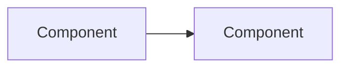

<!-- Generated by magenta build. Do not edit this file. -->

# Magenta artifact templates

Copy the template. Replace each `<...>` placeholder. Delete the sections that do not apply, and write the reason in the handoff note.

## Template: adr

````markdown
# ADR-NNNN: <decision title>

| Field | Value |
|---|---|
| Status | Proposed |
| Date | <date> |
| Decider | <human> |
| Source | <work item, RFC, or design note> |

## Context
## Decision
## Options considered
## Consequences
- Good:
- Bad:
- Follow-up:
## Reversibility
One-way door / two-way door. Reason:
````

## Template: brief

````markdown
# Brief: <title>

| Work item | Step | Owner | Status | Inputs (commit SHA) |
|---|---|---|---|---|
| <ID>-<slug> | <step> | <agent> | DRAFT / DONE / BLOCKED / NEEDS-HUMAN | <files> @ <sha> |

## Task
- Task type: <bug | performance | improvement | feature | investigation | review | incident | security | upgrade | tests | design>
- Playbook: <name>
- Lane: <lite | standard | full>. Reason:
- Goal (one sentence):

## Success criteria
| Metric or check | Current value (source) | Target | How we measure |
|---|---|---|---|

## Scope
- In:
- Out:

## Team
| Agent | Reason |
|---|---|

## Constraints known now
- 

## Assumptions and questions
- ASSUMPTION:
- QUESTION:

## Plan and constraint ledger (lite lane only)

## Handoff

- Done:
- Open:
- Next owner:
- What to check:
````

## Template: cdr

````markdown
# CDR: <short title>

| Work item | Step | Owner | Status | Inputs (commit SHA) |
|---|---|---|---|---|
| <ID>-<slug> | <step> | <agent> | DRAFT / DONE / BLOCKED / NEEDS-HUMAN | <files> @ <sha> |

1. Convention (with a file reference):
2. Problem in this case (with evidence):
3. Alternative and blast radius:
4. Scope: this change only / new convention for all new code
5. Approval: <Principal decision note link> or <ADR link>
````

## Template: decision-note

````markdown
# Decision note: <title>

| Work item | Step | Owner | Status | Inputs (commit SHA) |
|---|---|---|---|---|
| <ID>-<slug> | <step> | <agent> | DRAFT / DONE / BLOCKED / NEEDS-HUMAN | <files> @ <sha> |

## Question
## Positions
| Side | Claim | Evidence | Impact | Reversibility |
|---|---|---|---|---|
## Decision and reason
## Objections (kept in the record)
````

## Template: design-note

````markdown
# Design note: <title>

| Work item | Step | Owner | Status | Inputs (commit SHA) |
|---|---|---|---|---|
| <ID>-<slug> | <step> | <agent> | DRAFT / DONE / BLOCKED / NEEDS-HUMAN | <files> @ <sha> |

## Context and scope
## Proposed design

## Contracts (API, events, data ownership)
## NFR budgets
| NFR | Budget | Source |
|---|---|---|
| p99 latency | | |
## Risks and open questions
## Decisions
| Decision | One-way or two-way door | ADR needed |
|---|---|---|

## Handoff

- Done:
- Open:
- Next owner:
- What to check:
````

## Template: plan

````markdown
# Plan: <title>

| Work item | Step | Owner | Status | Inputs (commit SHA) |
|---|---|---|---|---|
| <ID>-<slug> | <step> | <agent> | DRAFT / DONE / BLOCKED / NEEDS-HUMAN | <files> @ <sha> |

## Task type, playbook, and lane
- Task type and playbook:
- Lane: <lite|standard|full>. Reason:

## Constraint ledger
| ID | Source (Architect, QA, Principal, Project, Human) | Constraint | How we verify |
|---|---|---|---|
| C1 | | | |

## Tasks
| ID | Task | Owner agent | Scope (files or modules) | Inputs | Output | Status |
|---|---|---|---|---|---|---|
| T1 | | | | | | TODO |

## Rollout and rollback

## Readiness depth
<lite: rollback and observability | standard: the items that apply | full: all items>

## Handoff

- Done:
- Open:
- Next owner:
- What to check:
````

## Template: prd-review

````markdown
# PRD review: <title>

| Work item | Step | Owner | Status | Inputs (commit SHA) |
|---|---|---|---|---|
| <ID>-<slug> | <step> | <agent> | DRAFT / DONE / BLOCKED / NEEDS-HUMAN | <files> @ <sha> |

## Verdict
GO / GO WITH CHANGES / NEEDS DISCOVERY / NO GO. Total score: <n>/18. Confidence: HIGH / MEDIUM / LOW.

## Summary
Three sentences: the problem, the proposed solution, the main risk.

## Scorecard
| Dimension | Score | Evidence |
|---|---|---|
| Problem | | |
| Users | | |
| Value | | |
| Alternatives | | |
| Smallest slice | | |
| Feasibility | | |
| Risks | | |
| Testability | | |
| Urgency | | |

## Product risks
- Value:
- Usability:
- Feasibility:
- Viability:

## Cheaper alternatives

## Smallest slice and experiment
- Slice:
- Primary metric (baseline, target):
- Guardrail metrics:

## Non-goals

## Questions for the human PM
1. 

## Assumptions
- ASSUMPTION:

## Handoff

- Done:
- Open:
- Next owner:
- What to check:
````

## Template: product-context

````markdown
# Product Context

The human owns this file. The PM agent reads it.

## Strategy and goals
## OKRs for this period
## Personas and their jobs to be done
## Key metrics (with current baselines)
## Constraints (legal, budget, dates)
````

## Template: project-context

````markdown
# Project Context Profile

Status: DRAFT | CONFIRMED (commit <sha>, confirmed by <human>, <date>)

## Stack and versions
- Language:
- Frameworks:
- Build tool and command:

## Architecture
- Style (with evidence):
- Module map:

## Conventions (each with a file reference)
- Naming:
- Error handling:
- Data access:
- Transactions:
- Logging, metrics, tracing:
- Configuration:
- Dependency injection:

## Tests
- Frameworks:
- Unit test folder:
- Integration and acceptance test folder:
- Commands (unit, integration, all):

## CI and quality gates
- CI file:
- Lint and format:

## Do not change
- 

## Open questions
- QUESTION:
````

## Template: qa-report

````markdown
# QA report: <title>

| Work item | Step | Owner | Status | Inputs (commit SHA) |
|---|---|---|---|---|
| <ID>-<slug> | <step> | <agent> | DRAFT / DONE / BLOCKED / NEEDS-HUMAN | <files> @ <sha> |

## Verdict
PASS / PASS WITH RISKS / FAIL

## Test results
| Suite | Command | Result |
|---|---|---|

## Performance results (performance tasks)
| Metric | Baseline | After | Target | Result |
|---|---|---|---|---|
| p50 | | | | |
| p95 | | | | |
| p99 | | | | |
| Throughput | | | | |
| Error rate | | | | |

Method: tool, load profile, warm-up, duration, samples, runs, environment.

## Acceptance criteria coverage
| Acceptance criterion | Test | Result |
|---|---|---|

## Defects
| ID | Severity | Steps | Expected | Actual |
|---|---|---|---|---|

## Open risks

## Handoff

- Done:
- Open:
- Next owner:
- What to check:
````

## Template: request

````markdown
# Request

Source: <link to the PRD or ticket, or "conversation">
Date: <date>

```UNTRUSTED
<the request text, copied without changes>
```
````

## Template: retro

````markdown
# Retrospective: <title>

| Work item | Step | Owner | Status | Inputs (commit SHA) |
|---|---|---|---|---|
| <ID>-<slug> | <step> | <agent> | DRAFT / DONE / BLOCKED / NEEDS-HUMAN | <files> @ <sha> |

## What worked
## What did not work
## Cost (tokens or turns, time)
## Proposed rule changes (maximum three)
1. 
## Lessons for .magenta/lessons.md
````

## Template: review

````markdown
# Final review: <title>

| Work item | Step | Owner | Status | Inputs (commit SHA) |
|---|---|---|---|---|
| <ID>-<slug> | <step> | <agent> | DRAFT / DONE / BLOCKED / NEEDS-HUMAN | <files> @ <sha> |

## Result
APPROVED / CHANGES REQUESTED. Open BLOCKER: <n>. Open MAJOR: <n>.

## Findings
| Severity | File:line | Finding | Risk | Fix |
|---|---|---|---|---|

## Constraint check
| ID | Constraint | Result (PASS, FAIL, WAIVED) | Evidence |
|---|---|---|---|

## Production readiness
| Item | Status | Evidence | Action |
|---|---|---|---|

## Follow-ups (not in this change)

## Handoff

- Done:
- Open:
- Next owner:
- What to check:
````

## Template: rfc

````markdown
# RFC: <title>

| Work item | Step | Owner | Status | Inputs (commit SHA) |
|---|---|---|---|---|
| <ID>-<slug> | <step> | <agent> | DRAFT / DONE / BLOCKED / NEEDS-HUMAN | <files> @ <sha> |

## Summary
## Context, goals, non-goals
## Options
### Option A
### Option B
## Trade-off matrix and recommendation
## Contracts and data ownership
## NFR budgets
## Migration and rollout plan
| Step | Change | Exit criterion | Rollback |
|---|---|---|---|
## Fitness functions
## Risks, objections, open questions
## Decisions that need an ADR

## Handoff

- Done:
- Open:
- Next owner:
- What to check:
````

## Template: state

````yaml
work_item: <ID>-<slug>
lane: <lite|standard|full>
step: <current step>
gates:
  # Only the human approves a gate. The Principal records the approval from the conversation.
  prd-go:           { status: pending, by: null, at: null, note: null }
  scope-and-design: { status: pending, by: null, at: null, note: null }
  merge:            { status: pending, by: null, at: null, note: null }
  release:          { status: pending, by: null, at: null, note: null }
open_questions: []
````

## Template: stories

````markdown
# Stories: <title>

| Work item | Step | Owner | Status | Inputs (commit SHA) |
|---|---|---|---|---|
| <ID>-<slug> | <step> | <agent> | DRAFT / DONE / BLOCKED / NEEDS-HUMAN | <files> @ <sha> |

## Story S1: <title>
As a <persona>, I want <capability>, so that <outcome>.

Business acceptance criteria:
1. 

Out of scope:
- 

## Handoff

- Done:
- Open:
- Next owner:
- What to check:
````

## Template: test-plan

````markdown
# Test plan: <title>

| Work item | Step | Owner | Status | Inputs (commit SHA) |
|---|---|---|---|---|
| <ID>-<slug> | <step> | <agent> | DRAFT / DONE / BLOCKED / NEEDS-HUMAN | <files> @ <sha> |

## Strategy
- In scope:
- Out of scope:
- Levels (unit, integration, contract, E2E) and reasons:

## Performance test (performance tasks)
- Tool and harness:
- Load profile (arrival rate or concurrency, payload, data size):
- Warm-up, duration, samples, runs:
- Environment:
- Thresholds (from the success criteria):

## Risks
| Risk | Level | Covered by |
|---|---|---|

## Acceptance scenarios
```gherkin
Feature: <feature>
  Scenario: AC-<story>-1 <title>
    Given
    When
    Then
```

## Edge cases
| ID | Edge case | Technique | Risk | Test or accepted gap |
|---|---|---|---|---|

## Traceability
| Acceptance criterion | Test |
|---|---|

## Manual exploratory charters

## Handoff

- Done:
- Open:
- Next owner:
- What to check:
````
