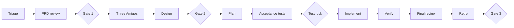

<!-- Generated by magenta build. Do not edit this file. -->

# Magenta workflows

Select the lane first. If more than one lane matches, select the heavier lane. Money, security, data migration, or a one-way-door decision always means the full lane.

Gates: Gate 1 PRD go, Gate 2 scope and design, Gate 3 merge, Gate 4 release (full lane). Only a human approves a gate.

## Lane: lite

Use it for a bug fix or a small change in one module, with low risk, that is easy to revert.

1. `magenta:principal`: triage, select the lane, write `04-plan.md` with one task.
2. `magenta:engineer` or `magenta:frontend`: fix with TDD. For a bug, first write a test that reproduces it.
3. `magenta:qa`: quick check. Write `07-qa-report.md`.
4. `magenta:principal`: review (rollback and observability only). Write `07-review.md`.
5. Gate 3, merge (human).

## Lane: standard

Use it for new behavior inside one bounded context.

1. `magenta:principal`: triage, create the work item, record `00-request.md`.
2. `magenta:product-manager`: PRD review. Write `01-prd-review.md`.
3. Gate 1, PRD go (human).
4. Three Amigos: `magenta:product-manager` writes `02-stories.md`. `magenta:qa` reviews it for testability and writes the Gherkin scenarios in `05-test-plan.md`. `magenta:engineer` gives feasibility notes in its final message (read-only).
5. `magenta:architect`: design note. Write `03-design.md` and ADRs if needed.
6. Gate 2, scope and design (human): the stories, the acceptance criteria, and the design.
7. `magenta:principal`: plan. Write `04-plan.md`. Give each maker task one scope.
8. `magenta:qa`: write the acceptance tests first (red).
9. Test lock (human): the human reviews the acceptance tests and runs `python3 magenta.py lock <repo> <ID>`. The makers start only after the lock exists.
10. `magenta:engineer` and `magenta:frontend`: implement their tasks with TDD. Run them one after the other, or in parallel only when their scopes do not overlap.
11. `magenta:qa`: verify. Write `07-qa-report.md`. Run `python3 magenta.py check-lock <repo> <ID>`: it must pass.
12. `magenta:principal`: final review in a clean context, with the readiness items that apply. Write `07-review.md`.
13. `magenta:principal`: retrospective. Write `08-retro.md`.
14. Gate 3, merge (human).

## Lane: full

Use it for more than one bounded context, a data migration, money or security flows, a new service, or a one-way-door decision.

All steps of the standard lane, with these changes:

- Step 5: `magenta:architect` writes a full RFC with two or three options.
- Before Gate 2: run the Design Review Board (workflow "design review").
- For flows with money or personal data: the skill `magenta:threat-model-stride`.
- Step 11: the full production readiness review (all items) and a rollout plan.
- After Gate 3: Gate 4, release (human).

## Workflow: design review (Design Review Board)

Use it for one-way-door decisions.

1. `magenta:architect` writes the options and the trade-off matrix in `03-design.md`.
2. `magenta:principal` starts these critics in parallel, each as a new subagent with a clean context and read-only work: `magenta:product-manager` (value and scope), `magenta:qa` (testability and risk), `magenta:engineer` (feasibility and effort), and `magenta:architect` in a second instance as a devil's advocate.
3. Each critic returns: the top three risks, the preferred option, and one question. Each critic returns its result in its final message. It does not write files.
4. `magenta:principal` writes a synthesis decision note in `decisions/`.
5. The human decides. `magenta:architect` records the result in an ADR.

## Workflow: pull request review panel

Use it for a pull request or a local diff.

1. `magenta:principal` gets the diff (`git diff <base>...HEAD`) and the related work item, if one exists.
2. `magenta:principal` starts three reviewers in parallel, read-only, each with a clean context:
   - `magenta:qa`: tests, edge cases, and acceptance criteria coverage.
   - `magenta:architect`: structure, boundaries, contracts, and conventions.
   - `magenta:principal` (a new instance): operability, security, and production readiness.
3. Each reviewer returns findings with severity, file and line, risk, and fix in its final message.
4. `magenta:principal` merges the findings into one report, removes duplicates, and writes `07-review.md` if a work item exists. If not, it gives the report in the conversation.
