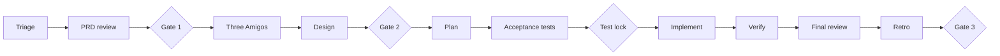
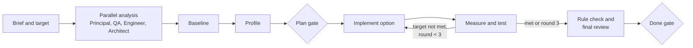

<!-- Generated by magenta build. Do not edit this file. -->

# Magenta workflows

Start with the routing section: select the task type, the team, and the lane. Then follow the playbook of the task type. Feature tasks use the lanes lite, standard, and full.

Gates for features: Gate 1 PRD go, Gate 2 scope and design, Gate 3 merge, Gate 4 release (full lane). Gates for other task types: plan gate and done gate. Only a human approves a gate.

## Routing: task type, team, and lane

The conductor (skill `magenta`) and the Principal use this table. First select the task type. Then select the team and the lane. Use the playbook of the task type.

### Task types

| Task type | Signals in the request | Playbook | Core team | Add these agents when |
|---|---|---|---|---|
| bug | error, exception, wrong result, "does not work", a failing test, a bug ticket | `bugfix` | `magenta:qa`, `magenta:engineer`, `magenta:principal` | `magenta:architect`: the root cause is structural or crosses a boundary. `magenta:frontend`: the bug is in client code. |
| performance | latency, p95, p99, slow, throughput, memory, CPU, cost of a query, Core Web Vitals | `performance` | `magenta:qa`, `magenta:engineer`, `magenta:architect`, `magenta:principal` | `magenta:frontend`: the target is a client metric. |
| improvement | refactor, clean up, simplify, tech debt, readability, duplication | `refactor` | `magenta:architect`, `magenta:qa`, `magenta:engineer`, `magenta:principal` | `magenta:frontend`: client code. |
| feature | a PRD, a new capability, a user story | `standard` or `full` | `magenta:product-manager`, `magenta:architect`, `magenta:qa`, `magenta:engineer`, `magenta:principal` | `magenta:frontend`: client work. |
| investigation | why, how does, explain, find out, "where is", analyze (without a change) | `investigation` | `magenta:principal` and the experts that the question needs | Add only the roles that the question needs. |
| review | review this PR, diff, design, RFC, or ADR | `pr-review` or `design-review` | `magenta:qa`, `magenta:architect`, `magenta:principal` | `magenta:product-manager`: user-facing scope. |
| incident | production is down or degraded, urgent, hotfix | `incident` | `magenta:principal`, `magenta:engineer`, `magenta:qa` | `magenta:architect`: after the mitigation, for the root cause. |
| security | vulnerability, CVE, authentication, authorization, secrets | `security` | `magenta:principal`, `magenta:architect`, `magenta:engineer`, `magenta:qa` | |
| upgrade | upgrade a library, a framework, or a runtime | `upgrade` | `magenta:engineer`, `magenta:qa`, `magenta:principal` | `magenta:architect`: a major version or a breaking change. |
| tests | add tests, coverage, flaky tests, test speed | `tests` | `magenta:qa`, `magenta:engineer` | `magenta:principal`: the change affects CI for the team. |
| design | design a solution, write an RFC or an ADR, select a technology | `design` | `magenta:architect`, `magenta:principal` | `magenta:product-manager`: scope or value questions. `magenta:qa`: testability. |

If a request has two types (for example "find out the performance issue and fix it"), use the type of the final result (performance). Use the steps of the other type inside it.

### Team rules

1. Use the smallest team that covers the risks. Each agent in the team has a reason. Write the reason in the brief.
2. QA is in the team for each change of behavior, performance, or tests.
3. The Principal plans each standard or full task and does each final review.
4. Add the Architect when the change crosses a module or service boundary, changes a data model, a schema, a cache, a public API, or an event contract, adds a dependency or a technology, or touches an area with an ADR.
5. Add the Product Manager when the change affects users, scope, or priority, or when the success metric is a product metric.
6. Use `magenta:engineer` for server code and `magenta:frontend` for client code. Use both only when the task needs both, with separate scopes.

### Lanes

| Lane | Use it when | Human gates |
|---|---|---|
| lite | One module, low risk, easy to revert, the change is obvious. | Done gate only. Ask before the work only if the request is not clear. |
| standard | One bounded context, or the solution is not obvious, or a measurable target. | Plan gate, done gate. Feature tasks also have the PRD gate. |
| full | More than one bounded context, data migration, money or security flows, a one-way-door decision. | PRD gate (features), plan and design gate, done gate, release gate. |

If more than one lane matches, use the heavier lane. Money, security, data migration, or a one-way-door decision always means the full lane.

### Gates for tasks that are not features

- **Plan gate.** The human approves the brief (with the success criteria), the team, the plan, and the constraint ledger.
- **Done gate.** The human reviews the result, the evidence, and the constraint check. Then the human merges, asks for more work, or stops.

### Constraint ledger

Each task has a constraint ledger in `04-plan.md` (lite lane: in `00-brief.md`). It lists the rules that the result must not break:

| Source | Examples |
|---|---|
| Architect | ADRs, module boundaries, dependency rules, data ownership, consistency rules, API and event contracts, fitness functions |
| QA | All tests pass. Locked acceptance tests do not change. No new flaky tests. Performance thresholds. Edge cases covered. |
| Principal | Rollback, feature flag when necessary, observability, resilience, capacity, security |
| Project | The conventions in the project context, lint, format |
| Human | The constraints in the request |

A candidate solution that breaks one constraint is rejected, even when it is faster. Only the human can waive a constraint, in writing. The final review records the result of each constraint.

## Lane: lite

Use it for a bug fix or a small change in one module, with low risk, that is easy to revert.

1. `magenta:principal`: triage, select the lane, write `04-plan.md` with one task.
2. `magenta:engineer` or `magenta:frontend`: fix with TDD. For a bug, first write a test that reproduces it.
3. `magenta:qa`: quick check. Write `07-qa-report.md`.
4. `magenta:principal`: review (rollback and observability only). Write `07-review.md`.
5. Gate 3, merge (human).

## Lane: standard

Use it for new behavior inside one bounded context.

1. `magenta:principal`: triage, create the work item, record `00-request.md`.
2. `magenta:product-manager`: PRD review. Write `01-prd-review.md`.
3. Gate 1, PRD go (human).
4. Three Amigos: `magenta:product-manager` writes `02-stories.md`. `magenta:qa` reviews it for testability and writes the Gherkin scenarios in `05-test-plan.md`. `magenta:engineer` gives feasibility notes in its final message (read-only).
5. `magenta:architect`: design note. Write `03-design.md` and ADRs if needed.
6. Gate 2, scope and design (human): the stories, the acceptance criteria, and the design.
7. `magenta:principal`: plan. Write `04-plan.md`. Give each maker task one scope.
8. `magenta:qa`: write the acceptance tests first (red).
9. Test lock (human): the human reviews the acceptance tests and runs `python3 magenta.py lock <repo> <ID>`. The makers start only after the lock exists.
10. `magenta:engineer` and `magenta:frontend`: implement their tasks with TDD. Run them one after the other, or in parallel only when their scopes do not overlap.
11. `magenta:qa`: verify. Write `07-qa-report.md`. Run `python3 magenta.py check-lock <repo> <ID>`: it must pass.
12. `magenta:principal`: final review in a clean context, with the readiness items that apply. Write `07-review.md`.
13. `magenta:principal`: retrospective. Write `08-retro.md`.
14. Gate 3, merge (human).

## Lane: full

Use it for more than one bounded context, a data migration, money or security flows, a new service, or a one-way-door decision.

All steps of the standard lane, with these changes:

- Step 5: `magenta:architect` writes a full RFC with two or three options.
- Before Gate 2: run the Design Review Board (workflow "design review").
- For flows with money or personal data: the skill `magenta:threat-model-stride`.
- Step 11: the full production readiness review (all items) and a rollout plan.
- After Gate 3: Gate 4, release (human).

## Playbook: bugfix

1. Conductor: write the brief: the symptom, the expected and the actual behavior, the environment, and the evidence (logs and tickets in `UNTRUSTED` blocks).
2. `magenta:qa`: reproduce the bug. Write the smallest failing test that shows it, at the lowest level that reproduces it. If QA cannot reproduce it, stop and ask the human for more data.
3. `magenta:engineer`: find the root cause with the skill `magenta:root-cause-analysis`. For a difficult bug, the conductor runs competing hypotheses (pattern P9): two or three investigators in parallel (`magenta:engineer`, `magenta:architect`, `magenta:qa`), read-only, each tries to prove or disprove one hypothesis.
4. Plan gate (standard lane): the root cause, the fix plan, and the constraint ledger.
5. `magenta:engineer`: fix the root cause, not the symptom. Use TDD. The reproduction test must pass. Keep the change small.
6. `magenta:qa`: run all tests. Add tests for the edge cases near the root cause. Search for the same defect in similar code. Write `07-qa-report.md`.
7. `magenta:principal`: final review with the constraint check. Add `magenta:architect` for a structural root cause.
8. Done gate: the root cause, the fix, the tests, the risks, and the follow-ups that prevent the same class of bug.

## Playbook: performance

Use it for latency, throughput, memory, CPU, and query cost. The result must meet the target and must not break any constraint.

1. Conductor: write the brief. Make the target measurable: the metric (for example p95 and p99 latency), the scope (endpoint or job), the load profile, the environment, and the current value with its source. Ask for the source of the current numbers (production metrics, a load test, or a local benchmark).
2. In parallel, read-only:
   - `magenta:principal`: check that the target is realistic. Make a latency budget from the current numbers. Start the constraint ledger.
   - `magenta:qa`: write the measurement plan in `05-test-plan.md` with the skill `magenta:performance-investigation`: tool, load profile, warm-up, duration, sample size, and the functional regression tests.
   - `magenta:engineer`: trace the code path of the scope (handler, services, data access, remote calls, serialization). List the suspect hot spots with evidence.
   - `magenta:architect`: find the structural causes (N+1 queries, missing indexes, chatty remote calls, missing or wrong cache, large payloads). Give two or three options with trade-offs in `03-design.md`. Write the structural constraints (consistency, staleness, boundaries, ADRs).
3. `magenta:qa`: measure the baseline with the plan. Write it in `07-qa-report.md`. If the system cannot run, ask the human for production metrics or a runnable environment.
4. `magenta:engineer`: profile the scope under load. Find where the time goes. Update the latency budget with the evidence.
5. Plan gate: the baseline, the latency budget, the options, the selected first option, and the constraint ledger.
6. `magenta:engineer`: implement the option with the best gain for its risk. Keep the behavior the same. For two promising options, the conductor runs a tournament (pattern P8): two engineers in separate git worktrees, and QA measures both.
7. `magenta:qa`: measure again under the same conditions. Run the functional tests. Compare the distributions, not only the averages.
8. Repeat steps 6 and 7 until the target is met or three rounds are done. Then stop. If the target is not possible inside the constraints, `magenta:architect` writes the options that need a larger change (for example a new cache layer or a data model change), and the conductor asks the human.
9. `magenta:architect`: rule check of the change (ADRs, boundaries, contracts, consistency). `magenta:principal`: final review with the readiness items (cache invalidation, memory, observability of the target percentiles, rollback or feature flag) and the constraint check.
10. Done gate: a table with the baseline, the result, and the target for each metric; what changed; the constraint check; the risks.

## Playbook: refactor (improvement)

1. Conductor: write the brief: the reason (readability, duplication, coupling, tech debt), the scope, and how to measure the improvement (for example complexity, duplication, dependency rules).
2. `magenta:architect`: describe the target structure and the steps. Write a fitness function when the target is a structural rule.
3. `magenta:qa`: write characterization tests that lock the current behavior of the scope (skill `magenta:safe-refactoring`).
4. Plan gate (standard lane).
5. `magenta:engineer`: refactor in small steps. Each step keeps all tests green. Keep refactoring commits separate from behavior changes. No behavior change in this playbook.
6. `magenta:qa`: run all tests and the characterization tests. Compare the behavior.
7. `magenta:principal`: final review with the constraint check. Confirm that the improvement is measurable.
8. Done gate.

## Playbook: investigation

Use it for a question or an analysis without a change.

1. Conductor: write the question and what a good answer contains. A work item is not necessary, unless the human asks for one.
2. Select only the experts that the question needs. Run them in parallel, read-only, each with a clear sub-question. Examples: `magenta:engineer` traces the code; `magenta:architect` explains the structure and the decisions; `magenta:qa` examines the tests and the risks; `magenta:principal` examines operations.
3. Conductor: merge the answers. Remove duplicates. Mark disagreements and give the evidence of each side.
4. Report: the answer, the evidence (file and line, command output), the confidence, and the open questions. If a change is useful, propose the task type and the playbook for it. Do not change code.

## Playbook: incident

Use it when production is down or degraded. Speed and safety come first.

1. `magenta:principal`: lead. Write a short timeline in `00-brief.md` (conductor) and the impact.
2. Mitigate first: `magenta:principal` proposes the fastest safe mitigation (rollback, feature flag off, scale, rate limit). The human approves and runs it. Agents do not have production access.
3. `magenta:engineer` and `magenta:qa` in parallel, read-only: find the cause from the evidence that the human gives (logs, metrics, traces in `UNTRUSTED` blocks) with the skill `magenta:root-cause-analysis`.
4. Continue with the `bugfix` playbook for the permanent fix (lite lane is not permitted for an incident fix).
5. `magenta:principal`: write a blameless postmortem with the skill `magenta:incident-response`: timeline, root cause, what worked, what did not, and actions with owners.

## Playbook: upgrade

1. Conductor: write the brief: the dependency, the current and the target version, and the reason (security, support, features).
2. `magenta:engineer`: read the release notes and the migration guide. List the breaking changes that affect the project, with file references.
3. `magenta:architect` (major version or breaking change): assess the impact on the structure and the contracts.
4. `magenta:qa`: list the tests that cover the affected areas. Add tests where the coverage is missing.
5. Plan gate (standard lane).
6. `magenta:engineer`: upgrade in small steps. Fix the deprecations. Do not mix the upgrade with other changes.
7. `magenta:qa`: run all tests. Compare the behavior and, for runtime upgrades, the performance.
8. `magenta:principal`: final review with the rollback plan and the constraint check. Done gate.

## Playbook: security

1. Conductor: write the brief. Put the vulnerability report or the scanner output in an `UNTRUSTED` block. Do not copy secrets.
2. `magenta:principal`: make a threat model with the skill `magenta:threat-model-stride` for the affected flow. Rate the risk.
3. `magenta:architect`: find the structural cause (trust boundaries, authorization model, data exposure).
4. `magenta:qa`: write a test that proves the vulnerability (safely, in the test environment only).
5. Plan gate (full lane for money, personal data, or authentication flows).
6. `magenta:engineer`: fix with TDD. Do not log sensitive data.
7. `magenta:qa`: verify the fix and the related abuse cases. `magenta:principal`: final review with the constraint check.
8. Done gate. The human decides the disclosure and the release.

## Playbook: tests

Use it to add tests, increase useful coverage, fix flaky tests, or make the tests faster.

1. Conductor: write the brief with the goal (for example "cover the order cancel rules" or "remove the flaky test X").
2. `magenta:qa`: analyze the risks and the current tests. Select the test levels. For a flaky test, find the cause (time, order, shared state, network, concurrency).
3. `magenta:qa`: write the tests. `magenta:engineer` changes production code only when a test needs a seam, and only with a small, separate commit.
4. `magenta:qa`: run the tests several times to prove that they are stable.
5. `magenta:principal` (when CI for the team changes): review. Done gate.

## Playbook: design

Use it to design a solution, to write an RFC or an ADR, or to select a technology, without implementation.

1. Conductor: write the brief: the problem, the constraints, and the decision that the human needs.
2. `magenta:architect`: write the design note or the RFC with two or three options and a trade-off matrix.
3. For a one-way-door decision, run the `design-review` workflow (Design Review Board).
4. `magenta:principal`: review the delivery and operations aspects (migration, rollout, cost, risk).
5. Plan gate is the decision gate: the human selects the option. `magenta:architect` writes the ADR.

## Workflow: design review (Design Review Board)

Use it for one-way-door decisions.

1. `magenta:architect` writes the options and the trade-off matrix in `03-design.md`.
2. `magenta:principal` starts these critics in parallel, each as a new subagent with a clean context and read-only work: `magenta:product-manager` (value and scope), `magenta:qa` (testability and risk), `magenta:engineer` (feasibility and effort), and `magenta:architect` in a second instance as a devil's advocate.
3. Each critic returns: the top three risks, the preferred option, and one question. Each critic returns its result in its final message. It does not write files.
4. `magenta:principal` writes a synthesis decision note in `decisions/`.
5. The human decides. `magenta:architect` records the result in an ADR.

## Workflow: pull request review panel

Use it for a pull request or a local diff.

1. `magenta:principal` gets the diff (`git diff <base>...HEAD`) and the related work item, if one exists.
2. `magenta:principal` starts three reviewers in parallel, read-only, each with a clean context:
   - `magenta:qa`: tests, edge cases, and acceptance criteria coverage.
   - `magenta:architect`: structure, boundaries, contracts, and conventions.
   - `magenta:principal` (a new instance): operability, security, and production readiness.
3. Each reviewer returns findings with severity, file and line, risk, and fix in its final message.
4. `magenta:principal` merges the findings into one report, removes duplicates, and writes `07-review.md` if a work item exists. If not, it gives the report in the conversation.

The conductor can run this panel directly for the task type "review". Each reviewer also checks the constraint ledger of the related work item, if one exists.
