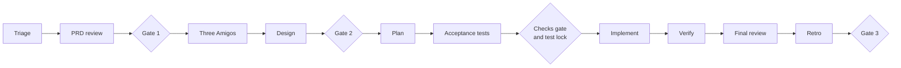
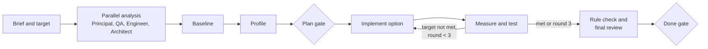

<!-- Generated by magenta build. Do not edit this file. -->

# Magenta workflows

Start with the routing section: select the task type, the team, and the lane. Then follow the playbook of the task type. Feature tasks use the lanes lite, standard, and full.

Gates for features: Gate 1 PRD go, Gate 2 scope and design, Gate 3 merge, Gate 4 release (full lane). Gates for other task types: plan gate and done gate. Only a human approves a gate.

## Routing: task type, mode, team, and lane

The conductor (skill `magenta`) and the Principal use these tables. First select the task type. Then select the mode: the default mode (lead, checks, lenses) or team mode. In team mode, select the team and the lane, and use the playbook of the task type.

### Task types

| Task type | Signals in the request | Playbook | Core team | Add these agents when |
|---|---|---|---|---|
| bug | error, exception, wrong result, "does not work", a failing test, a bug ticket | `bugfix` | `magenta:qa`, `magenta:engineer`, `magenta:principal` | `magenta:architect`: the root cause is structural or crosses a boundary. `magenta:frontend`: the bug is in client code. |
| performance | latency, p95, p99, slow, throughput, memory, CPU, cost of a query, Core Web Vitals | `performance` | `magenta:qa`, `magenta:engineer`, `magenta:architect`, `magenta:principal` | `magenta:frontend`: the target is a client metric. `magenta:database`: a slow query or an index. `magenta:sre`: production capacity or resource limits. |
| improvement | refactor, clean up, simplify, tech debt, readability, duplication | `refactor` | `magenta:architect`, `magenta:qa`, `magenta:engineer`, `magenta:principal` | `magenta:frontend`: client code. |
| feature | a PRD, a new capability, a user story | `standard` or `full` | `magenta:product-manager`, `magenta:architect`, `magenta:qa`, `magenta:engineer`, `magenta:principal` | `magenta:frontend`: client work. `magenta:database`: a schema change. `magenta:security`: authentication, money, or personal data. `magenta:sre`: a new endpoint, remote call, or rollout risk. `magenta:writer`: user documentation. |
| investigation | why, how does, explain, find out, "where is", analyze (without a change) | `investigation` | `magenta:principal` and the experts that the question needs | Add only the roles that the question needs. |
| review | review this PR, diff, design, RFC, or ADR | `pr-review` or `design-review` | `magenta:qa`, `magenta:architect`, `magenta:principal` | `magenta:product-manager`: user-facing scope. |
| incident | production is down or degraded, urgent, hotfix | `incident` | `magenta:sre`, `magenta:principal`, `magenta:engineer`, `magenta:qa` | `magenta:architect`: after the mitigation, for the root cause. `magenta:platform`: a deployment or infrastructure cause. |
| security | vulnerability, CVE, authentication, authorization, secrets | `security-fix` | `magenta:security`, `magenta:principal`, `magenta:engineer`, `magenta:qa` | `magenta:architect`: a structural fix. `magenta:platform`: a pipeline, image, or infrastructure fix. |
| upgrade | upgrade a library, a framework, or a runtime | `upgrade` | `magenta:engineer`, `magenta:qa`, `magenta:principal` | `magenta:architect`: a major version or a breaking change. `magenta:security`: the upgrade fixes a CVE. `magenta:platform`: a runtime or base image upgrade. |
| infrastructure | CI, CD, pipeline, Docker, Kubernetes, Helm, Terraform, deployment, build speed | `infrastructure` | `magenta:platform`, `magenta:sre` | `magenta:security`: secrets, permissions, or network exposure. |
| reliability | SLO, alert, dashboard, observability, timeout, retry, circuit breaker, capacity, postmortem action | `reliability` | `magenta:sre`, `magenta:engineer` or `magenta:platform`, `magenta:qa` | `magenta:principal`: a change of the SLOs of the team. |
| data | schema change, migration, backfill, index, data cleanup | `standard` or `full` | `magenta:database`, `magenta:architect`, `magenta:engineer`, `magenta:qa` | `magenta:sre`: a long backfill or a large table. |
| docs | documentation, README, guide, release notes, changelog | `docs` | `magenta:writer` | The owner of the subject reviews (for example `magenta:architect` for a design guide). |
| tests | add tests, coverage, flaky tests, test speed | `tests` | `magenta:qa`, `magenta:engineer` | `magenta:principal`: the change affects CI for the team. |
| design | design a solution, write an RFC or an ADR, select a technology | `design` | `magenta:architect`, `magenta:principal` | `magenta:product-manager`: scope or value questions. `magenta:qa`: testability. |

If a request has two types (for example "find out the performance issue and fix it"), use the type of the final result (performance). Use the steps of the other type inside it.

### Modes

Use the default mode for most tasks. Use team mode only when a team trigger applies. The request can select the mode: `--team` or `--lead`.

| Task type | Lead (default mode) | Checks first | Lenses |
|---|---|---|---|
| bug | `magenta:engineer` or `magenta:frontend` | QA: a test that reproduces the bug (red). | QA. Architect, when the cause is structural. |
| performance | `magenta:engineer` or `magenta:frontend` | QA: a measurement with the thresholds (red). Architect: the structural constraints (consistency, staleness, boundaries). | QA, Architect, Principal |
| improvement | `magenta:engineer` or `magenta:frontend` | QA: characterization tests (green). Architect: the target structure as rules (red). | Architect, QA |
| tests | `magenta:qa` | The project checks. | Principal, when the change affects CI for the team. |
| upgrade | `magenta:engineer` | The project checks. QA: smoke tests for the changed behavior. | QA, Principal |
| incident | `magenta:engineer` | QA: a test for the failure mode, when there is time. | SRE, Principal |
| feature (small and clear) | `magenta:engineer` or `magenta:frontend` | QA: acceptance tests (red). Architect: the contracts. | QA, Architect, Principal |
| investigation | None. The conductor or `magenta:principal` answers, read-only. | None. | None. |
| review | None. | None. | The review panel: QA, Architect, Principal. |
| design | `magenta:architect` | None. | Principal |
| infrastructure | `magenta:platform` | SRE: the lint and validate commands of the changed files (red when they find the problem). | SRE. Security, for secrets, permissions, or exposure. |
| reliability | `magenta:engineer` (code) or `magenta:platform` (alerts, dashboards, manifests) | SRE: the rule as a check. QA: a test for the failure behavior. | SRE, QA |
| docs | `magenta:writer` | The project checks (Markdown lint, link check), when they exist. | The owner of the subject. |
| security | Team mode. | | |
| data | Team mode (a schema change is a team trigger). | | |

### Team triggers

Use team mode when one of these applies. Write the trigger in the brief.

1. The request starts with `--team`.
2. A feature with a PRD, or a change of user-facing scope or priority. Add the Product Manager.
3. A one-way-door decision, a new technology, or a change of a public API, an event contract, a schema, or data ownership.
4. Money, security, personal data, or a data migration. These always use the full lane.
5. The change crosses more than one bounded context.
6. The lead did not pass the checks after three rounds in the default mode.
7. Two or more promising solutions need a measurement (tournament, P8), or a difficult bug needs competing hypotheses (P9).

The playbooks and the lanes below describe team mode. In the default mode, the agents use the same skills (for example `magenta:performance-investigation`, `magenta:root-cause-analysis`, and `magenta:safe-refactoring`) inside the steps of the conductor.

### Lenses

A lens is a read-only review from the view of one role. Each role describes its lens in the section "Review lens". Select one to three lenses by risk:

| Lens | Use it when the change |
|---|---|
| QA | changes behavior |
| Architect | touches structure: boundaries, dependencies, contracts, data model, areas with an ADR |
| Principal | is in the standard or full lane (production readiness and final review) |
| SRE | adds or changes remote calls, timeouts, retries, resource use, configuration, or rollout |
| Security | touches authentication, authorization, input from outside, secrets, money, personal data, or dependencies |
| Database | changes a schema, a migration, a query on a hot path, or a transaction |

### Team rules

1. Use the smallest team that covers the risks. Each agent in the team has a reason. Write the reason in the brief.
2. QA is in the team for each change of behavior, performance, or tests.
3. The Principal plans each standard or full task and does each final review.
4. Add the Architect when the change crosses a module or service boundary, changes a data model, a schema, a cache, a public API, or an event contract, adds a dependency or a technology, or touches an area with an ADR.
5. Add the SRE when the change affects production behavior: new or changed endpoints, remote calls, timeouts, retries, resource use, configuration, or rollout.
6. Add the Security Engineer when the change touches authentication, authorization, input from outside, secrets, money, personal data, or adds a dependency.
7. Add the Database Engineer when the change touches a schema, a migration, a backfill, an index, or a slow query. The Engineer writes the migration code from its plan.
8. Use the Platform Engineer for CI/CD pipelines, container files, deployment manifests, and infrastructure code. Other makers do not change these files.
9. Add the Technical Writer when user documentation or release notes are part of "done".
10. Add the Product Manager when the change affects users, scope, or priority, or when the success metric is a product metric.
11. Use `magenta:engineer` for server code and `magenta:frontend` for client code. Use both only when the task needs both, with separate scopes.

### Lanes

| Lane | Use it when | Human gates |
|---|---|---|
| lite | One module, low risk, easy to revert, the change is obvious. | Checks gate (only when there are new checks), done gate. |
| standard | One bounded context, or the solution is not obvious, or a measurable target. | Checks gate or plan gate, done gate. Feature tasks also have the PRD gate. |
| full | More than one bounded context, data migration, money or security flows, a one-way-door decision. | PRD gate (features), plan and design gate, done gate, release gate. |

If more than one lane matches, use the heavier lane. Money, security, data migration, or a one-way-door decision always means the full lane.

### Gates for tasks that are not features

- **Checks gate.** The human approves the new checks: the success criteria and the rules as commands. In the default mode, the human also approves the brief and the short plan at this gate.
- **Plan gate (team mode).** The human approves the brief (with the success criteria), the team, the plan, and the constraint ledger.
- **Done gate.** The human reviews the result, the verify table, and the constraint check. Then the human merges, asks for more work, or stops.

### Constraint ledger

Each task has a constraint ledger in `00-brief.md` (team mode: `04-plan.md`). It lists the rules that the result must not break. Write each constraint as a check when a command can test it:

| Source | Examples |
|---|---|
| Architect | ADRs, module boundaries, dependency rules, data ownership, consistency rules, API and event contracts, fitness functions |
| QA | All tests pass. Locked acceptance tests do not change. No new flaky tests. Performance thresholds. Edge cases covered. |
| Principal | Rollback, feature flag when necessary, observability, resilience, capacity, security |
| Project | The conventions in the project context, lint, format |
| Human | The constraints in the request |

A candidate solution that breaks one constraint is rejected, even when it is faster. Only the human can waive a constraint, in writing. The final review records the result of each constraint.

## Lane: lite

Use it for a bug fix or a small change in one module, with low risk, that is easy to revert.

1. `magenta:principal`: triage, select the lane, write `04-plan.md` with one task.
2. `magenta:qa`: for a bug, write a test that reproduces it, and its check. The conductor locks the test, and the human approves the check.
3. `magenta:engineer` or `magenta:frontend`: fix with TDD. Run verify until all checks pass.
4. `magenta:qa`: quick check: run verify. Write `07-qa-report.md`.
5. `magenta:principal`: review (rollback and observability only). Write `07-review.md`.
6. Gate 3, merge (human).

## Lane: standard

Use it for new behavior inside one bounded context.

1. `magenta:principal`: triage, create the work item, record `00-request.md`.
2. `magenta:product-manager`: PRD review. Write `01-prd-review.md`.
3. Gate 1, PRD go (human).
4. Three Amigos: `magenta:product-manager` writes `02-stories.md`. `magenta:qa` reviews it for testability and writes the Gherkin scenarios in `05-test-plan.md`. `magenta:engineer` gives feasibility notes in its final message (read-only).
5. `magenta:architect`: design note. Write `03-design.md` and ADRs if needed.
6. Gate 2, scope and design (human): the stories, the acceptance criteria, and the design.
7. `magenta:principal`: plan. Write `04-plan.md`. Give each maker task one scope.
8. `magenta:qa`: write the acceptance tests first (red), and their checks in `.magenta/checks/qa.yaml`.
9. Checks gate and test lock: the conductor (or the Principal) locks the test files with the verify script (`lock <ID> <files>`). The human reviews the tests and approves the checks. The makers start only after the lock exists and the new checks fail (red).
10. `magenta:engineer` and `magenta:frontend`: implement their tasks with TDD. Run them one after the other, or in parallel only when their scopes do not overlap. Each maker runs verify until its checks pass.
11. `magenta:qa`: verify. Write `07-qa-report.md`. Run verify: all checks pass, and the locked tests did not change.
12. `magenta:principal`: final review in a clean context, with the readiness items that apply. Write `07-review.md`.
13. `magenta:principal`: retrospective. Write `08-retro.md`.
14. Gate 3, merge (human).

## Lane: full

Use it for more than one bounded context, a data migration, money or security flows, a new service, or a one-way-door decision.

All steps of the standard lane, with these changes:

- Step 5: `magenta:architect` writes a full RFC with two or three options.
- Before Gate 2: run the Design Review Board (workflow "design review").
- For flows with money or personal data: the skill `magenta:threat-model-stride`.
- Step 11: the full production readiness review (all items) and a rollout plan.
- After Gate 3: Gate 4, release (human).

## Playbook: bugfix

1. Conductor: write the brief: the symptom, the expected and the actual behavior, the environment, and the evidence (logs and tickets in `UNTRUSTED` blocks).
2. `magenta:qa`: reproduce the bug. Write the smallest failing test that shows it, at the lowest level that reproduces it, and its check in `.magenta/checks/qa.yaml`. The conductor locks the test, and the human approves the check. If QA cannot reproduce it, stop and ask the human for more data.
3. `magenta:engineer`: find the root cause with the skill `magenta:root-cause-analysis`. For a difficult bug, the conductor runs competing hypotheses (pattern P9): two or three investigators in parallel (`magenta:engineer`, `magenta:architect`, `magenta:qa`), read-only, each tries to prove or disprove one hypothesis.
4. Plan gate (standard lane): the root cause, the fix plan, and the constraint ledger.
5. `magenta:engineer`: fix the root cause, not the symptom. Use TDD. Run verify until the reproduction check passes. Keep the change small.
6. `magenta:qa`: run all tests. Add tests for the edge cases near the root cause. Search for the same defect in similar code. Write `07-qa-report.md`.
7. `magenta:principal`: final review with the constraint check. Add `magenta:architect` for a structural root cause.
8. Done gate: the root cause, the fix, the tests, the risks, and the follow-ups that prevent the same class of bug.

## Playbook: performance

Use it for latency, throughput, memory, CPU, and query cost. The result must meet the target and must not break any constraint.

1. Conductor: write the brief. Make the target measurable: the metric (for example p95 and p99 latency), the scope (endpoint or job), the load profile, the environment, and the current value with its source. Ask for the source of the current numbers (production metrics, a load test, or a local benchmark).
2. In parallel, read-only:
   - `magenta:principal`: check that the target is realistic. Make a latency budget from the current numbers. Start the constraint ledger.
   - `magenta:qa`: write the measurement plan in `05-test-plan.md` with the skill `magenta:performance-investigation`: tool, load profile, warm-up, duration, sample size, and the functional regression tests. Write the thresholds as checks in `.magenta/checks/qa.yaml` (set `full` for a load test).
   - `magenta:engineer`: trace the code path of the scope (handler, services, data access, remote calls, serialization). List the suspect hot spots with evidence.
   - `magenta:architect`: find the structural causes (N+1 queries, missing indexes, chatty remote calls, missing or wrong cache, large payloads). Give two or three options with trade-offs in `03-design.md`. Write the structural constraints (consistency, staleness, boundaries, ADRs).
3. `magenta:qa`: measure the baseline with the plan. Write it in `07-qa-report.md`. If the system cannot run, ask the human for production metrics or a runnable environment.
4. `magenta:engineer`: profile the scope under load. Find where the time goes. Update the latency budget with the evidence.
5. Plan gate: the baseline, the latency budget, the options, the selected first option, and the constraint ledger.
6. `magenta:engineer`: implement the option with the best gain for its risk. Keep the behavior the same. For two promising options, the conductor runs a tournament (pattern P8): two engineers in separate git worktrees, and QA measures both.
7. `magenta:qa`: measure again under the same conditions: run verify with the set `task`. Run the functional tests. Compare the distributions, not only the averages.
8. Repeat steps 6 and 7 until the target is met or three rounds are done. Then stop. If the target is not possible inside the constraints, `magenta:architect` writes the options that need a larger change (for example a new cache layer or a data model change), and the conductor asks the human.
9. `magenta:architect`: rule check of the change (ADRs, boundaries, contracts, consistency). `magenta:principal`: final review with the readiness items (cache invalidation, memory, observability of the target percentiles, rollback or feature flag) and the constraint check.
10. Done gate: a table with the baseline, the result, and the target for each metric; what changed; the constraint check; the risks.

## Playbook: refactor (improvement)

1. Conductor: write the brief: the reason (readability, duplication, coupling, tech debt), the scope, and how to measure the improvement (for example complexity, duplication, dependency rules).
2. `magenta:architect`: describe the target structure and the steps. Write the target as checks in `.magenta/checks/architect.yaml` when it is a structural rule. These checks fail before the refactor.
3. `magenta:qa`: write characterization tests that lock the current behavior of the scope (skill `magenta:safe-refactoring`), and their checks. These checks pass before the refactor. The conductor locks the tests, and the human approves the checks.
4. Plan gate (standard lane).
5. `magenta:engineer`: refactor in small steps. Each step keeps all checks green, except the target checks of the Architect, which become green at the end. Keep refactoring commits separate from behavior changes. No behavior change in this playbook.
6. `magenta:qa`: run all tests and the characterization tests. Compare the behavior.
7. `magenta:principal`: final review with the constraint check. Confirm that the improvement is measurable.
8. Done gate.

## Playbook: investigation

Use it for a question or an analysis without a change.

1. Conductor: write the question and what a good answer contains. A work item is not necessary, unless the human asks for one.
2. Select only the experts that the question needs. Run them in parallel, read-only, each with a clear sub-question. Examples: `magenta:engineer` traces the code; `magenta:architect` explains the structure and the decisions; `magenta:qa` examines the tests and the risks; `magenta:principal` examines operations.
3. Conductor: merge the answers. Remove duplicates. Mark disagreements and give the evidence of each side.
4. Report: the answer, the evidence (file and line, command output), the confidence, and the open questions. If a change is useful, propose the task type and the playbook for it. Do not change code.

## Playbook: incident

Use it when production is down or degraded. Speed and safety come first.

1. `magenta:sre`: lead the response with the skill `magenta:incident-response`. Return the impact and a short timeline in the final message. The conductor writes them in `00-brief.md`.
2. Mitigate first: `magenta:sre` proposes the fastest safe mitigation (rollback, feature flag off, scale, rate limit, traffic shift). The human approves and runs it. Agents do not have production access.
3. `magenta:engineer` and `magenta:qa` in parallel, read-only: find the cause from the evidence that the human gives (logs, metrics, traces in `UNTRUSTED` blocks) with the skill `magenta:root-cause-analysis`. Add `magenta:platform` when a deployment or the infrastructure can be the cause.
4. Continue with the `bugfix` playbook for the permanent fix (lite lane is not permitted for an incident fix). The `magenta:principal` does the final review.
5. `magenta:sre`: write a blameless postmortem with the template `postmortem` in `docs/postmortems/`. Each action item has an owner, and a check when a command can test it. Update or write the runbook.

## Playbook: upgrade

1. Conductor: write the brief: the dependency, the current and the target version, and the reason (security, support, features).
2. `magenta:engineer`: read the release notes and the migration guide. List the breaking changes that affect the project, with file references.
3. `magenta:architect` (major version or breaking change): assess the impact on the structure and the contracts.
4. `magenta:qa`: list the tests that cover the affected areas. Add tests where the coverage is missing.
5. Plan gate (standard lane).
6. `magenta:engineer`: upgrade in small steps. Fix the deprecations. Do not mix the upgrade with other changes.
7. `magenta:qa`: run all tests. Compare the behavior and, for runtime upgrades, the performance.
8. `magenta:principal`: final review with the rollback plan and the constraint check. Done gate.

## Playbook: security-fix

1. Conductor: write the brief. Put the vulnerability report or the scanner output in an `UNTRUSTED` block. Do not copy secrets.
2. `magenta:security`: make a threat model with the skill `magenta:threat-model-stride` for the affected flow, and triage the finding (skill `magenta:dependency-security` for a CVE). Rate the risk in `03-security.md`.
3. `magenta:architect`: find the structural cause (trust boundaries, authorization model, data exposure), when the fix is structural.
4. `magenta:qa`: write a test that proves the vulnerability (safely, in the test environment only). `magenta:security`: write the scanner rule or the check that keeps the defect out.
5. Plan gate (full lane for money, personal data, or authentication flows).
6. `magenta:engineer`: fix with TDD. Do not log sensitive data. `magenta:platform`: fix pipelines, images, or infrastructure, when the cause is there.
7. `magenta:qa`: verify the fix and the related abuse cases. `magenta:security`: Security lens on the diff. `magenta:principal`: final review with the constraint check.
8. Done gate. The human decides the disclosure, the rotation of secrets, and the release.

## Playbook: tests

Use it to add tests, increase useful coverage, fix flaky tests, or make the tests faster.

1. Conductor: write the brief with the goal (for example "cover the order cancel rules" or "remove the flaky test X").
2. `magenta:qa`: analyze the risks and the current tests. Select the test levels. For a flaky test, find the cause (time, order, shared state, network, concurrency).
3. `magenta:qa`: write the tests. `magenta:engineer` changes production code only when a test needs a seam, and only with a small, separate commit.
4. `magenta:qa`: run the tests several times to prove that they are stable.
5. `magenta:principal` (when CI for the team changes): review. Done gate.

## Playbook: design

Use it to design a solution, to write an RFC or an ADR, or to select a technology, without implementation.

1. Conductor: write the brief: the problem, the constraints, and the decision that the human needs.
2. `magenta:architect`: write the design note or the RFC with two or three options and a trade-off matrix.
3. For a one-way-door decision, run the `design-review` workflow (Design Review Board).
4. `magenta:principal`: review the delivery and operations aspects (migration, rollout, cost, risk).
5. Plan gate is the decision gate: the human selects the option. `magenta:architect` writes the ADR.

## Workflow: design review (Design Review Board)

Use it for one-way-door decisions.

1. `magenta:architect` writes the options and the trade-off matrix in `03-design.md`.
2. `magenta:principal` starts these critics in parallel, each as a new subagent with a clean context and read-only work: `magenta:product-manager` (value and scope), `magenta:qa` (testability and risk), `magenta:engineer` (feasibility and effort), and `magenta:architect` in a second instance as a devil's advocate.
3. Each critic returns: the top three risks, the preferred option, and one question. Each critic returns its result in its final message. It does not write files.
4. `magenta:principal` writes a synthesis decision note in `decisions/`.
5. The human decides. `magenta:architect` records the result in an ADR.

## Workflow: pull request review panel

Use it for a pull request or a local diff.

1. `magenta:principal` gets the diff (`git diff <base>...HEAD`) and the related work item, if one exists.
2. `magenta:principal` starts three reviewers in parallel, read-only, each with a clean context:
   - `magenta:qa`: tests, edge cases, and acceptance criteria coverage.
   - `magenta:architect`: structure, boundaries, contracts, and conventions.
   - `magenta:principal` (a new instance): operability, security, and production readiness.
3. Each reviewer returns findings with severity, file and line, risk, and fix in its final message.
4. `magenta:principal` merges the findings into one report, removes duplicates, and writes `07-review.md` if a work item exists. If not, it gives the report in the conversation.

The conductor can run this panel directly for the task type "review". Each reviewer also checks the constraint ledger of the related work item, if one exists.

## Playbook: docs

Use it to write or update documentation without a code change.

1. Conductor: write the brief: the readers, the document type (tutorial, how-to guide, reference, or explanation), and the source of truth (code, ADRs, the expert).
2. `magenta:writer`: write or update the documents with the skill `magenta:technical-writing`. Copy commands and options from the code. Ask questions instead of guessing.
3. The owner of the subject reviews the facts, read-only: for example `magenta:architect` for a design guide, `magenta:sre` for an operations guide, `magenta:platform` for a deployment guide.
4. Run the Markdown lint and the link check, when the project has them.
5. Done gate.

## Playbook: infrastructure

Use it for CI/CD pipelines, container files, Kubernetes manifests, Helm charts, and infrastructure as code.

1. Conductor: write the brief: the goal (for example "the pipeline runs in under 10 minutes" or "the service runs as non-root"), the environments, and the constraints.
2. `magenta:sre`: write the checks: the lint and validate commands for the changed files (`actionlint`, `hadolint`, `kubeconform`, `helm lint`, `terraform validate`), and the operations rules (probes, resources, rollback). `magenta:security`: add the checks for secrets, permissions, and exposure, when they apply.
3. Checks gate.
4. `magenta:platform`: make the change with the skill of the area. Run verify until the checks pass. Write the steps that the human runs (plan, apply, rollout, rollback).
5. `magenta:sre` lens, and `magenta:security` lens when it applies.
6. Done gate. The human runs `plan` and `apply`, or merges the pipeline change. Agents never apply or deploy.

## Playbook: reliability

Use it for SLOs, alerts, dashboards, observability, resilience (timeouts, retries, circuit breakers), capacity, and postmortem actions.

1. Conductor: write the brief: the user journey, the current SLI values and their source, and the target.
2. `magenta:sre`: write `03-reliability.md` with the skills `magenta:slo-observability` and `magenta:resilience-review`. Write the checks: lint of the alert rules, code rules as `git grep` checks. `magenta:qa`: write tests for the failure behavior (for example "the dependency times out, and the service returns the fallback").
3. Checks gate.
4. The lead makes the change: `magenta:engineer` for code (timeouts, retries, fallbacks, metrics), `magenta:platform` for alert rules, dashboards, and manifests. Run verify until the checks pass.
5. `magenta:sre` lens, and `magenta:qa` lens for changed behavior.
6. Done gate: the SLO effect, the alerts and their runbooks, and the rollback.
