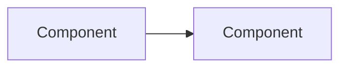

# Design note: <title>

{{header}}

## Context and scope
## Proposed design

## Contracts (API, events, data ownership)
## NFR budgets
| NFR | Budget | Source |
|---|---|---|
| p99 latency | | |
## Risks and open questions
## Decisions
| Decision | One-way or two-way door | ADR needed |
|---|---|---|

{{handoff}}
