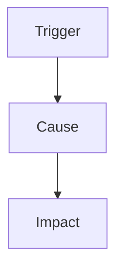

# Postmortem: <title>

| Field | Value |
|---|---|
| Date | |
| Duration | <start> to <end> (<minutes>) |
| Severity | |
| Authors | |
| Status | DRAFT / REVIEWED |

This postmortem is blameless. It is about systems and processes, not people.

## Impact
<users affected, requests failed, money, error budget used>

## Timeline (UTC)
| Time | Event |
|---|---|

## Root cause
<the chain of causes; use five whys or a cause tree>

## What went well
## What went badly
## Where we were lucky

## Action items
| Action | Type (prevent, detect, mitigate) | Owner | Due date | Check |
|---|---|---|---|---|
