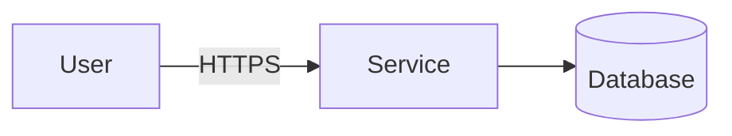

# Security review: <title>

{{header}}

## Scope
- Flows and entry points:
- Data: <personal data, payment data, secrets>
- Trust boundaries:

## Data flow

## Threats (STRIDE)
| Element | Threat | Risk (likelihood x impact) | Mitigation | Status |
|---|---|---|---|---|

## Findings
| Severity | File:line | Finding | Fix | Check |
|---|---|---|---|---|

## Dependencies
| Package and version | Advisory | Reachable | Decision |
|---|---|---|---|

## Risks for the human
| Risk | Why it remains | Decision (accept, fix, defer) and date |
|---|---|---|

## Verdict
PASS / PASS WITH RISKS / FAIL

{{handoff}}
