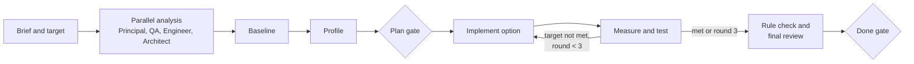

## Playbook: performance

Use it for latency, throughput, memory, CPU, and query cost. The result must meet the target and must not break any constraint.

1. Conductor: write the brief. Make the target measurable: the metric (for example p95 and p99 latency), the scope (endpoint or job), the load profile, the environment, and the current value with its source. Ask for the source of the current numbers (production metrics, a load test, or a local benchmark).
2. In parallel, read-only:
   - `principal`: check that the target is realistic. Make a latency budget from the current numbers. Start the constraint ledger.
   - `qa`: write the measurement plan in `05-test-plan.md` with the skill `performance-investigation`: tool, load profile, warm-up, duration, sample size, and the functional regression tests.
   - `engineer`: trace the code path of the scope (handler, services, data access, remote calls, serialization). List the suspect hot spots with evidence.
   - `architect`: find the structural causes (N+1 queries, missing indexes, chatty remote calls, missing or wrong cache, large payloads). Give two or three options with trade-offs in `03-design.md`. Write the structural constraints (consistency, staleness, boundaries, ADRs).
3. `qa`: measure the baseline with the plan. Write it in `07-qa-report.md`. If the system cannot run, ask the human for production metrics or a runnable environment.
4. `engineer`: profile the scope under load. Find where the time goes. Update the latency budget with the evidence.
5. Plan gate: the baseline, the latency budget, the options, the selected first option, and the constraint ledger.
6. `engineer`: implement the option with the best gain for its risk. Keep the behavior the same. For two promising options, the conductor runs a tournament (pattern P8): two engineers in separate git worktrees, and QA measures both.
7. `qa`: measure again under the same conditions. Run the functional tests. Compare the distributions, not only the averages.
8. Repeat steps 6 and 7 until the target is met or three rounds are done. Then stop. If the target is not possible inside the constraints, `architect` writes the options that need a larger change (for example a new cache layer or a data model change), and the conductor asks the human.
9. `architect`: rule check of the change (ADRs, boundaries, contracts, consistency). `principal`: final review with the readiness items (cache invalidation, memory, observability of the target percentiles, rollback or feature flag) and the constraint check.
10. Done gate: a table with the baseline, the result, and the target for each metric; what changed; the constraint check; the risks.

