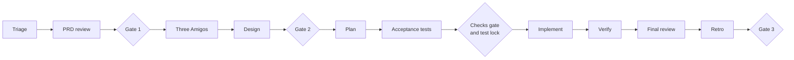

## Lane: standard

Use it for new behavior inside one bounded context.

1. `principal`: triage, create the work item, record `00-request.md`.
2. `product-manager`: PRD review. Write `01-prd-review.md`.
3. Gate 1, PRD go (human).
4. Three Amigos: `product-manager` writes `02-stories.md`. `qa` reviews it for testability and writes the Gherkin scenarios in `05-test-plan.md`. `engineer` gives feasibility notes in its final message (read-only).
5. `architect`: design note. Write `03-design.md` and ADRs if needed.
6. Gate 2, scope and design (human): the stories, the acceptance criteria, and the design.
7. `principal`: plan. Write `04-plan.md`. Give each maker task one scope.
8. `qa`: write the acceptance tests first (red), and their checks in `.magenta/checks/qa.yaml`.
9. Checks gate and test lock: the conductor (or the Principal) locks the test files with the verify script (`lock <ID> <files>`). The human reviews the tests and approves the checks. The makers start only after the lock exists and the new checks fail (red).
10. `engineer` and `frontend`: implement their tasks with TDD. Run them one after the other, or in parallel only when their scopes do not overlap. Each maker runs verify until its checks pass.
11. `qa`: verify. Write `07-qa-report.md`. Run verify: all checks pass, and the locked tests did not change.
12. `principal`: final review in a clean context, with the readiness items that apply. Write `07-review.md`.
13. `principal`: retrospective. Write `08-retro.md`.
14. Gate 3, merge (human).

